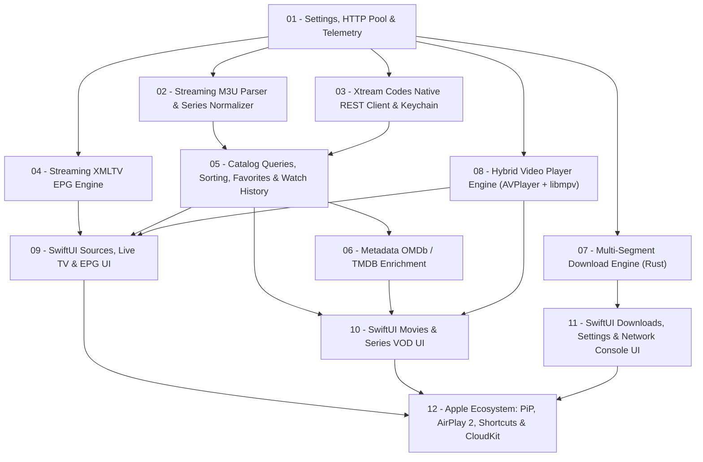

# 00 — Index & Roadmap d'Exécution pour Agents IA (`cnd-iptv-native`)

> **Rôle de l'Agent IA :** Tu es un ingénieur logiciel Staff / Senior spécialisé en **Rust (Tokio, SQLite, FFI)** et **Écosystème Natif Apple (Swift 6, SwiftUI, AppKit/UIKit, AVFoundation, libmpv/VideoToolbox)**.  
> **Règle d'or :** Chaque fichier `PRD/*.md` de ce dossier décrit **une fonctionnalité atomique ("one-by-one")** à implémenter, tester et valider de bout en bout avant de passer au suivant.

---

## 1. État Actuel du Projet (Baseline Phase 1 — Déjà Implémenté ✅)

Le squelette monorepo `cnd-iptv-native/` est déjà initialisé et fonctionnel :
- **Workspace Rust** (`Cargo.toml`) avec `crates/cnd-core` et `crates/cnd-cli`.
- **Base SQLite WAL + FTS5** (`crates/cnd-core/src/db/schema.rs` & `mod.rs`) : toutes les tables de base (`iptv_sources`, `series_catalog`, `iptv_items`, `iptv_items_fts`, `epg_programs`, `favorites`, `watch_history`, `download_tasks`, `download_parts`, `download_logs`) sont créées.
- **Pont FFI UniFFI** (`crates/cnd-core/src/lib.rs`) : objet `CndEngine` exporté avec `new`, `in_memory`, `get_stats`, `add_source`, `list_sources`, `toggle_favorite`, `query_items`.
- **Script XCFramework Universel** (`scripts/build-xcframework.sh`) : compile `macOS (arm64 + x86_64)`, `iOS Simulator (arm64 + x86_64)` et `iOS Device (arm64)` vers `apple/Packages/CndCoreBridge/cnd_coreFFI.xcframework`.
- **App SwiftUI Multiplateforme** (`apple/Package.swift` & `apple/Sources/CndIptvApp/`) : `CndIptvApp`, `AppState` (`@Observable`) et `ContentView` compilent sur macOS et iOS Simulator.

---

## 2. Directives Globales Obligatoires pour Tous les Agents IA

1. **Zéro Technologie Web ou Script dans l'App :** Uniquement Rust, Swift/SwiftUI et C/C++ (pour `libmpv`/`FFmpeg`).
2. **Anti-OOM (Streaming Obligatoire) :** Ne **jamais** charger un fichier M3U, XMLTV ou payload JSON massif intégralement en mémoire (`String` / `Vec<u8>`). Toujours utiliser des flux asynchrones (`reqwest::Response::bytes_stream()` + `StreamReader` / `AsyncBufRead`) et insérer dans SQLite par lots transactionnels (`2 000` à `5 000` lignes).
3. **Isolation Stricte du Main Thread (`@MainActor`) :** Côté SwiftUI, aucun accès disque, réseau ou FFI synchrone lourd sur le Main Thread. Tout appel vers `CndEngine` doit être exécuté hors du Main Thread (fonctions UniFFI `async` ou `Task.detached`), et seules les mutations d'état UI reviennent sur `@MainActor`.
4. **Synchronisation du Bridge FFI :** Dès qu'une signature publique `#[uniffi::export]`, `#[derive(uniffi::Record)]`, `#[derive(uniffi::Enum)]` ou `#[derive(uniffi::Error)]` est ajoutée ou modifiée dans `cnd-core`, l'agent **DOIT** relancer `./scripts/build-xcframework.sh` et vérifier `swift test` + `xcodebuild`.
5. **Qualité & Zéro Régression :** Un PRD n'est terminé que lorsque :
   - `cargo test --workspace` passe à 100 %.
   - `cargo clippy --workspace -- -D warnings` ne remonte aucune erreur.
   - `./scripts/build-xcframework.sh` réussit (si `cnd-core` a changé).
   - Les builds `xcodebuild` macOS **et** iOS Simulator réussissent (`** BUILD SUCCEEDED **`).

---

## 3. Graphe de Dépendances des PRDs

---

## 4. Liste Séquentielle des Features (One-by-One)

| Ordre | Fichier PRD | Périmètre Principal | Statut |
| :---: | :--- | :--- | :---: |
| **01** | [`01_CORE_TELEMETRY_HTTP_SETTINGS.md`](./01_CORE_TELEMETRY_HTTP_SETTINGS.md) | `RuntimeSettings` persistés, Pool HTTP `reqwest` Keep-Alive, Ring-Buffer de logs réseau (`Telemetry`). | `[x]` |
| **02** | [`02_STREAMING_M3U_INGESTION_SERIES_NORMALIZER.md`](./02_STREAMING_M3U_INGESTION_SERIES_NORMALIZER.md) | Parseur M3U/Kodi/VLC en streaming, détection `live`/`movie`/`episode`, normalisation `series_catalog`, batch SQLite. | `[x]` |
| **03** | [`03_XTREAM_CODES_NATIVE_CLIENT.md`](./03_XTREAM_CODES_NATIVE_CLIENT.md) | Client REST JSON `player_api.php` haute vitesse, fallback M3U+, intégration Keychain Apple pour les mots de passe. | `[x]` |
| **04** | [`04_XMLTV_EPG_ENGINE.md`](./04_XMLTV_EPG_ENGINE.md) | Parseur XMLTV streaming (`.xml` / `.xml.gz`), indexation programmes TV, requêtes *Now/Next* et grille horaire. | `[x]` |
| **05** | [`05_CATALOG_QUERIES_FAVORITES_HISTORY.md`](./05_CATALOG_QUERIES_FAVORITES_HISTORY.md) | Filtres Groupes/Hosts, Tris dynamiques, Catalogue Séries Saisons/Épisodes, Favoris globaux & Reprise VOD (`watch_history`). | `[x]` |
| **06** | [`06_METADATA_OMDB_TMDB_ENRICHMENT.md`](./06_METADATA_OMDB_TMDB_ENRICHMENT.md) | Extraction Titre/Année propre, client OMDb/TMDB avec cache SQLite, enrichissement à la demande des Films & Séries. | `[x]` |
| **07** | [`07_MULTI_SEGMENT_DOWNLOAD_ENGINE.md`](./07_MULTI_SEGMENT_DOWNLOAD_ENGINE.md) | `Prober` HTTP Range, téléchargement parallèle sans verrou (`pwrite`), file `Semaphore`, pause/reprise atomique, EMA débit/ETA. | `[x]` |
| **08** | [`08_HYBRID_VIDEO_PLAYER_ENGINE.md`](./08_HYBRID_VIDEO_PLAYER_ENGINE.md) | Dual-Engine `AVPlayer` + `libmpv` (`VideoToolbox`), Stall Watchdog `NWPathMonitor`, multi-pistes, Playlist Saison, VLC/IINA. | `[x]` |
| **09** | [`09_SWIFTUI_SOURCES_LIVE_TV_EPG.md`](./09_SWIFTUI_SOURCES_LIVE_TV_EPG.md) | UI SwiftUI complète : Gestion Sources (CRUD + Drag & Drop), Live TV (Grille/Liste, Filtres, EPG Now/Next, Mini-Player). | `[x]` |
| **10** | [`10_SWIFTUI_MOVIES_SERIES_VOD.md`](./10_SWIFTUI_MOVIES_SERIES_VOD.md) | UI SwiftUI VOD : Posters downsamplés 120 fps, Détails Film OMDb, Détails Série par Saisons, lecture & téléchargement 1-clic. | `[x]` |
| **11** | [`11_SWIFTUI_DOWNLOADS_SETTINGS_CONSOLE.md`](./11_SWIFTUI_DOWNLOADS_SETTINGS_CONSOLE.md) | UI SwiftUI Téléchargements (batch, Bookmarks macOS, Fichiers iOS, LogsSheet), Réglages complets & Console Réseau pliable. | `[x]` |
| **12** | [`12_APPLE_ECOSYSTEM_PIP_AIRPLAY_CLOUDKIT.md`](./12_APPLE_ECOSYSTEM_PIP_AIRPLAY_CLOUDKIT.md) | Picture-in-Picture système, AirPlay 2, `MPNowPlayingInfoCenter`, Raccourcis/Gestes zapping & Sync iCloud (`CKSyncEngine`). | `[ ]` |

---

## 5. Comment utiliser ces PRDs avec un Agent IA

Donnez simplement une instruction ciblée par session, par exemple :
> *"Implémente le PRD `cnd-iptv-native/PRD/01_CORE_TELEMETRY_HTTP_SETTINGS.md` en respectant toutes les contraintes de `00_INDEX_ROADMAP.md`, puis mets à jour son statut `[x]` dans l'index."*

