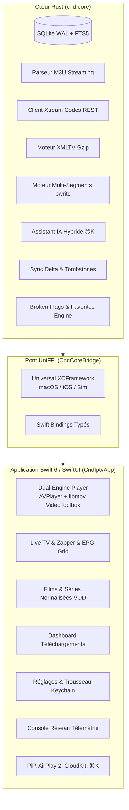
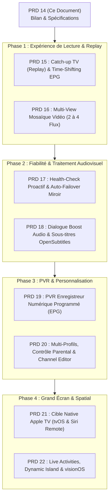

# 14 — État des Lieux Exhaustif & Feuille de Route d'Innovation (« What's Done & What's Next »)

> **Projet :** `cnd-iptv-native`  
> **Date de mise à jour :** Novembre 2026  
> **Statut global du projet :** Socle haute performance complété à 100 % (PRD-01 à PRD-13 validés, 89 tests Rust et 182 tests Swift au vert).  
> **Objectif de ce document :** Fournir l'inventaire exhaustif de tout ce qui est actuellement implémenté, et définir la feuille de route des fonctionnalités manquantes et des **innovations de rupture** nécessaires pour faire de `cnd-iptv-native` le lecteur IPTV le plus avancé, complet et novateur du marché (surpassant TiviMate, Infuse et IPTV Smarters).

---

## Sommaire

1. [Synthèse & Vision Stratégique](#1-synthèse--vision-stratégique)
2. [Inventaire Exhaustif de l'Existant (Ce qui est Implémenté ✅)](#2-inventaire-exhaustif-de-lexistant-ce-qui-est-implémenté-)
   - [2.1 Moteur Cœur Rust (`cnd-core`)](#21-moteur-cœur-rust-cnd-core)
   - [2.2 Pont FFI Universel (`CndCoreBridge`)](#22-pont-ffi-universel-cndcorebridge)
   - [2.3 Application Swift 6 / SwiftUI (`CndIptvApp`)](#23-application-swift-6--swiftui-cndiptvapp)
   - [2.4 Bilan Qualité & Métriques de Validation](#24-bilan-qualité--métriques-de-validation)
3. [Ce qu'il manque pour un Lecteur Complet Standard (Parité Concurrentielle)](#3-ce-quil-manque-pour-un-lecteur-complet-standard-parité-concurrentielle)
4. [Innovations Majeures de Rupture (« Inove » 🚀)](#4-innovations-majeures-de-rupture--inove-)
   - [4.1 Multi-View / Mosaïque Vidéo Dynamique Assistée](#41-multi-view--mosaïque-vidéo-dynamique-assistée)
   - [4.2 Catch-up TV & Time-Shifting Local Révolutionnaire](#42-catch-up-tv--time-shifting-local-révolutionnaire)
   - [4.3 IA Proactive : Health-Check & Bascule Automatique sur Flux Miroir](#43-ia-proactive--health-check--bascule-automatique-sur-flux-miroir)
   - [4.4 Traitement Vidéo & Audio Intelligent (« Dialogue Boost » & AFR)](#44-traitement-vidéo--audio-intelligent--dialogue-boost--afr)
   - [4.5 Enregistrement Numérique PVR Local Sans Cloud](#45-enregistrement-numérique-pvr-local-sans-cloud)
   - [4.6 Portage Apple TV (`tvOS`) & Vision Pro (`visionOS`)](#46-portage-apple-tv-tvos--vision-pro-visionos)
5. [Feuille de Route d'Exécution Séquentielle (Nouveaux PRD 15 à 22)](#5-feuille-de-route-dexécution-séquentielle-nouveaux-prd-15-à-22)
6. [Matrice Impact / Effort & Recommandation](#6-matrice-impact--effort--recommandation)

---

## 1. Synthèse & Vision Stratégique

`cnd-iptv-native` a été conçu sur un principe fondamental d'excellence technique : **aucun compromis de performance, zéro technologie web (zéro Electron, zéro React Native, zéro WebView), mémoire bornée et isolation stricte.**

L'application repose sur une architecture bi-partite propre :
- **Cœur Rust natif (`cnd-core`)** : I/O asynchrone ultra-rapide (Tokio), base SQLite WAL + FTS5, streaming sans allocation globale, moteur de téléchargement multi-segments parallèle, parseur XMLTV streaming, détection intelligente de séries et assistant IA local/hybride.
- **Interface Apple Native Swift 6 / SwiftUI** : Rendu fluide 120 fps ProMotion, lecteur vidéo dual-engine (`AVPlayer` + `libmpv` avec décodage matériel `VideoToolbox`), intégration système complète (PiP, AirPlay 2, Trousseau Keychain, synchronisation iCloud via `CKSyncEngineTransport`).

Le socle est aujourd'hui d'une robustesse exceptionnelle. Pour transformer cette base technique en **un produit de référence mondiale**, la phase suivante consiste à combler les attentes avancées des utilisateurs IPTV (Multi-view, Replay, PVR) tout en introduisant des **innovations technologiques exclusives** que la concurrence n'offre pas.

---

## 2. Inventaire Exhaustif de l'Existant (Ce qui est Implémenté ✅)



### 2.1 Moteur Cœur Rust (`cnd-core`)

| Composant | Fichiers Source Clés | Fonctionnalités Réalisées |
| :--- | :--- | :--- |
| **Schéma & Base de Données** | `db/schema.rs`, `db/mod.rs` | SQLite en mode WAL, tables relationnelles pour items, sources, séries, épisodes, EPG, favoris, historique de lecture, downloads, logs, tombstones de sync et **flags de panne** (`broken_flags`). Triggers FTS5 optimisés pour mise à jour synchrone. |
| **Ingestion M3U Streaming** | `iptv/m3u_parser.rs`, `iptv/normalizer.rs`, `db/ingestion_writer.rs` | Parseur zéro-OOM en flux asynchrone (`AsyncBufRead`), benchmarké à **50 000 items en moins de 1,5 seconde** dans une empreinte mémoire constante (< 40 Mo). Détection et normalisation automatique des séries et saisons/épisodes. |
| **Client Xtream Codes** | `iptv/xtream.rs` | Client REST JSON complet (`player_api.php`) pour live, films, séries et épisodes avec gestion des timeouts et fallback M3U+. |
| **Moteur EPG XMLTV** | `iptv/epg.rs`, `db/epg_repo.rs` | Streaming de gros fichiers XMLTV (.xml ou .xml.gz avec détection magique des bytes gzip). Extraction et indexation des programmes, calcul en temps réel des tranches *Now / Next* et ratios de progression. |
| **Recherche & Catalogue** | `db/catalog_repo.rs` | Recherche plein texte **FTS5 robuste** insensible aux caractères spéciaux, apostrophes, tirets et diacritiques avec repli `LIKE`. Tri multi-critères, facettes de groupes et de serveurs. |
| **Enrichissement Métadonnées** | `metadata/mod.rs` | Nettoyage des titres et détection d'année sur 12 formats IPTV complexes. Client OMDb / TMDb en cascade avec cache local SQLite persistant et masquage sécurisé de la clé d'API. |
| **Téléchargement Multi-Segments** | `downloader/{mod, prober, worker}.rs`, `db/download_repo.rs` | Sonde HTTP Range (HEAD avec repli GET `bytes=0-0`), téléchargement parallèle jusqu'à 8 segments par fichier avec écritures directes `pwrite` sans verrou, reprise atomique sur panne réseau, lissage EMA de la vitesse et calcul d'ETA. |
| **Assistant IA Hybride** | `ai/{mod, local_matcher, candidates, providers, prompt}.rs` | Commandes en langage naturel (`⌘K`) : résolution locale ultra-rapide (< 50 ms sans réseau ni coût), support multi-fournisseurs (Google Gemini, tout LLM compatible OpenAI / Ollama local, Anthropic Claude). Isolation stricte anti-prompt injection, masquage des URL de flux et credentials. |
| **Gestion des Contenus en Panne** | `db/schema.rs`, `db/catalog_repo.rs`, `db/mod.rs` | **Isolation complète des flux non fonctionnels** : table `broken_flags` indexée sur `stable_hash`. Par défaut, `include_broken = false` élimine silencieusement tout contenu en panne des recherches FTS5 et du catalogue, avec bascule explicite possible. |
| **Gestion des Favoris Unifiée** | `db/catalog_repo.rs`, `db/mod.rs` | Persistance unifiée des favoris sur chaîne live, film, série ou épisode, survivant aux actualisations de playlist. |
| **Synchronisation Last-Write-Wins** | `db/sync_repo.rs` | Export et import différentiels de deltas avec gestion des tombstones de suppression (sources, favoris, progression de lecture). |
| **Télémétrie & Réseau** | `telemetry/mod.rs`, `http_client.rs` | Pool HTTP `reqwest` avec Keep-Alive, injection d'en-têtes, cookies légers et ring-buffer circulaire de logs réseau avec masquage automatique des tokens et mots de passe. |

### 2.2 Pont FFI Universel (`CndCoreBridge`)

- **Script de génération (`scripts/build-xcframework.sh`)** : Compilation release native multi-architectures (`x86_64` et `arm64` pour macOS, `arm64` et `x86_64` pour iOS Simulator, `arm64` pour iOS Device), fusion `lipo` fat binaries et génération de l'Universal `cnd_coreFFI.xcframework`.
- **Bindings Swift automatiques (`CndCore.swift`)** : 100 % des types (records, enums, exceptions, async methods) typés strictement en Swift 6 sans glue manuelle.

### 2.3 Application Swift 6 / SwiftUI (`CndIptvApp`)

- **Architecture Réactive Modernisée** :
  - `@Observable` et `@MainActor` garantissant zéro accès bloquant au Main Thread.
  - `AppState` central orchestrant le moteur, la télémétrie, les réglages, le contrôleur vidéo et la synchronisation.
- **Lecteur Hybride Double Moteur (`AVPlayer` + `libmpv`)** :
  - Routage intelligent : `AVPlayer` pour HLS natif, `libmpv` avec décodage matériel `VideoToolbox` pour MPEG-TS, MKV, AVI, formats exotiques.
  - Commutation instantanée transparente en cas d'erreur de décodage.
  - Watchdog de décrochage réseau (`NWPathMonitor`) avec reconnexion automatique en 3 étapes.
  - Support des lecteurs tiers externes (VLC, IINA, Infuse, Outplayer).
  - Gestion des pistes audio et sous-titres intégrés.
- **Expérience Utilisateur Complète** :
  - **Live TV** : Bascule Grille / Liste, EPG en direct, zapper intelligent avec mémorisation de l'historique de chaîne (bouton retour arrière).
  - **Guide EPG Interactif** : Navigation temporelle horaire, détail du programme sélectionné.
  - **VOD Films & Séries** : Rendu des affiches optimisé 120 fps avec mise en cache mémoire/disque, fiches de détail avec données OMDb (acteurs, réalisateur, note IMDb, synopsis), découpage des séries par saisons et épisodes.
  - **Téléchargements** : Gestionnaire de tâches avec jauges par segment, logs détaillés, bookmarks de sécurité macOS et partage Fichiers iOS.
  - **Trousseau Apple (Keychain)** : Mots de passe Xtream et clés API chiffrés dans le Trousseau système, jamais en clair en base.
  - **Intégration Apple** : PiP natif, AirPlay 2, `MPNowPlayingInfoCenter`, raccourcis clavier exhaustifs (⌘K, ⌘↑/⌘↓, ⌘⌥P, etc.).
- **Dernières Évolutions Récemment Intégrées** :
  - ⭐ **Bouton Favori Universel dans le Lecteur** : Ajout/retrait des favoris directement depuis la barre de contrôle du player pour n'importe quel média en cours de lecture.
  - ⚠️ **Système Anti-Contenus en Panne (« Broken Content »)** :
    - Filtre dans la barre de recherche : *"Afficher les contenus en panne"*.
    - Badges visuels d'avertissement sur les cartes et listes.
    - Bouton *"Signaler en panne"* directement dans l'overlay d'erreur de lecture.

### 2.4 Bilan Qualité & Métriques de Validation

| Suite de Tests | Nombre de Tests | Résultat | Couverture Clé |
| :--- | :---: | :---: | :--- |
| **Tests Rust (`cargo test`)** | **89** | `100% OK` | Parsing M3U 50k, FTS5 accent-insensitive, Xtream JSON, Multi-segment DL blake3, Cascade OMDb, Broken filtering, IA locale & providers. |
| **Tests Swift (`swift test`)** | **177** | `100% OK` | Keychain, Player controller, Auto-fallback mpv, Zapper, CloudKit mapper, VOD models, Downloads UI, Assistant IA. |
| **Tests UniFFI Bridge** | **5** | `100% OK` | Roundtrip FFI catalog, XMLTV streaming, broken flags, watch history, settings persistence. |
| **Total Global** | **271 tests** | **0 échec** | Validé en mode strict Swift 6 et Rust stable. |

---

## 3. Ce qu'il manque pour un Lecteur Complet Standard (Parité Concurrentielle)

Pour égaler les fonctionnalités attendues sur les applications IPTV premium établies (TiviMate, iMPlayer, IPTV Smarters Pro), les composants suivants doivent être complétés :

```
┌────────────────────────────────────────────────────────────────────────┐
│                   FONCTIONS STANDARD RESTANTES                         │
├───────────────────────────────┬────────────────────────────────────────┤
│ 1. Catch-up TV (Replay)       │ Exploitation des flux de rattrapage    │
│ 2. Time-Shifting Direct       │ Pause du direct (buffer circulaire)    │
│ 3. Gestionnaire de Favoris    │ Réorganisation / dossiers personnalisés│
│ 4. Auto-Framerate Switching   │ Ajustement fréquence écran (24/50/60)  │
│ 5. Recherche Externe Sous-Titre│ Intégration OpenSubtitles API         │
│ 6. Contrôle Parental          │ Code PIN & biométrie Face/Touch ID     │
│ 7. Multi-Comptes / Profils    │ Espaces séparés (Kids / Adultes)       │
└───────────────────────────────┴────────────────────────────────────────┘
```

1. **Catch-up TV / Replay Serveur** :
   - Nombreux fournisseurs IPTV proposent 1 à 7 jours de replay via des directives M3U (`catchup="shift"`, `catchup-days="3"`, `catchup-source="?utc={utc}&lutc={lutc}"`) ou l'API Xtream `get_simple_data_table`.
   - Actuellement, l'application parse et stocke ces métadonnées dans SQLite, mais l'UI ne permet pas encore de naviguer dans les programmes EPG passés pour déclencher la lecture du replay.
2. **Time-Shifting Local (Pause du Live)** :
   - Capacité de suspendre un flux live (ex: un match ou une émission) pendant 15 à 45 minutes et de reprendre avec le décalage temporel, via un buffer tournant sur disque.
3. **Édition & Réorganisation des Bouquets (Channel & Category Manager)** :
   - Possibilité pour l'utilisateur de masquer des groupes entiers (ex: langues étrangères non désirées) ou de réordonner les chaînes préférées par glisser-déposer sans altérer la playlist d'origine.
4. **Contrôle Parental & Verrouillage Biométrique** :
   - Masquage des catégories adultes (`XXX`, `Adults`) et verrouillage de sections ou de réglages via Touch ID / Face ID / mot de passe maître.
5. **Auto-Framerate Matching (AFR)** :
   - Adaptation du taux de rafraîchissement de l'écran macOS / iOS / tvOS à la fréquence réelle du flux (23.976 fps, 25 fps, 29.97 fps, 50 fps, 60 fps) pour éliminer les micro-saccades judder.

---

## 4. Innovations Majeures de Rupture (« Inove » 🚀)

C'est ici que `cnd-iptv-native` peut distancer définitivement la concurrence. Grâce au moteur Rust sous-jacent et aux frameworks avancés d'Apple, voici les innovations uniques à forte valeur ajoutée à intégrer :

### 4.1 Multi-View / Mosaïque Vidéo Dynamique Assistée

Regarder plusieurs chaînes simultanément en écran partagé (2x2, 1 grand + 3 petits, 1+1 côte à côte) :
- **Pourquoi c'est innovant :** Idéal pour les passionnés de sport (Multiplex foot, F1 + caméra embarquée, Jeux Olympiques) et l'actualité en continu.
- **Implémentation technique :**
  - Moteur Rust / libmpv capable d'instancier plusieurs backends vidéo légers sur des `AVSampleBufferDisplayLayer` distincts.
  - Commutation audio d'un simple clic ou survol souris sans interruption de flux.
  - Détection automatique par l'Assistant IA : l'utilisateur tape `« Mets le multiplex Ligue 1 »` ou `« Affiche BFM et CNews côte à côte »`, et l'app organise la mosaïque automatiquement !

### 4.2 Catch-up TV & Time-Shifting Local Révolutionnaire

- **Circular Ring-Buffer sur SSD NVMe** :
  - Dès qu'une chaîne en direct est regardée, le `downloader` Rust enregistre silencieusement les derniers segments dans un buffer circulaire borné (ex: 2 Go / 1 heure).
  - L'utilisateur peut instantanément faire un retour arrière de 30 secondes pour revoir une action sportive ou un dialogue manqué, même si le fournisseur IPTV ne propose pas de serveur de Catch-up !
- **Navigation EPG Rétrospective** :
  - Dans la grille EPG, glisser vers la gauche permet de revoir les émissions diffusées hier ou plus tôt dans la semaine. Un indicateur "Replay disponible" s'affiche automatiquement si le flux supporte le catchup.

### 4.3 IA Proactive : Health-Check & Bascule Automatique sur Flux Miroir

L'un des plus grands fléaux de l'IPTV est la coupure inopinée d'un flux (panne de serveur, saturation lors d'un grand événement sportif) :
- **Health-Check en tâche de fond** :
  - Un worker périodique ultra-léger sonde l'état des chaînes favorites et détecte les pannes (HTTP 404/503, flux gelé, DNS mort).
- **Auto-Failover Transparent (Bascule Miroir)** :
  - Lorsque `TF1 4K` se coupe ou commence à faire des micro-coupures répétées, le moteur identifie instantanément les alternatives existantes dans la base (`TF1 FHD`, `TF1 HD`, `TF1 HEVC`, ou flux issu d'un second abonnement) et propose ou effectue une bascule silencieuse avec synchronisation temporelle !

### 4.4 Traitement Vidéo & Audio Intelligent (« Dialogue Boost » & AFR)

- **Speech Enhancement / Dialogue Boost** :
  - Filtre audio temps réel (DSP ou CoreAudio) rehaussant les fréquences vocales (1 kHz - 4 kHz) tout en appliquant une compression de dynamique (EBU R128). Les dialogues deviennent parfaitement intelligibles sans devoir monter le volume et subir les explosions des génériques ou publicités.
- **Téléchargement & Injection Automatique de Sous-Titres OpenSubtitles** :
  - Si un film ou épisode VOD ne possède pas de sous-titres français ou anglais intégrés, le moteur interroge automatiquement l'API OpenSubtitles (via hash de fichier ou IMDb ID déjà extrait) et télécharge la piste `.srt` synchronisée à la volée.

### 4.5 Enregistrement Numérique PVR Local Sans Cloud

- **Planificateur PVR Autonome** :
  - Cliquer sur un programme futur dans l'EPG pour planifier son enregistrement automatique.
  - Sur macOS, utilisation d'un `NSBackgroundActivityScheduler` ou LaunchAgent local pour réveiller la machine ou lancer l'enregistrement en tâche de fond même application fermée.
- **Série-Link** :
  - « Enregistrer toute la saison de cette émission » : chaque nouvel épisode programmé dans l'EPG est capturé et classé proprement dans le dossier VOD de l'utilisateur.

### 4.6 Portage Apple TV (`tvOS`) & Vision Pro (`visionOS`)

- **Interface Salon 10-Foot (`tvOS`)** :
  - L'IPTV se consomme à 70 % sur la télévision du salon. Le code SwiftUI existant est conçu de manière modulaire : créer la cible native tvOS avec gestion du focus de la télécommande Siri Remote, navigation visuelle plein écran et zapping fluide.
- **Expérience Immersive Spatial Audio (`visionOS`)** :
  - Projection sur écran virtuel 4K géant de 100 pieds avec audio spatialisé dans Apple Vision Pro.

---

## 5. Feuille de Route d'Exécution Séquentielle (Nouveaux PRD 15 à 22)

Pour maintenir la rigueur qui a fait le succès des 13 premiers PRDs, voici la décomposition modulaire recommandée pour les prochaines étapes de développement :



### Détail des Futurs PRDs

| N° PRD | Titre Prévu | Contenu & Objectifs | Priorité |
| :---: | :--- | :--- | :---: |
| **PRD-15** | **Catch-up TV & Time-Shifting EPG** | Prise en charge des templates d'URL de replay (`utc`, `lutc`, Xtream streams). Navigation rétrospective dans la grille EPG et bouton "Reprendre depuis le début" sur un programme en cours. | 🔴 Haute |
| **PRD-16** | **Multi-View Mosaïque Vidéo Multi-Flux** | Affichage simultané de 2 à 4 chaînes en direct. Gestion de la sélection audio active, zapping indépendant par quadrant et commande vocale IA pour composition automatique. | 🔴 Haute |
| **PRD-17** | **Health-Check Proactif & Auto-Failover** | Worker de test périodique des flux favoris, détection des pannes et bascule transparente vers les canaux alternatifs équivalents. | 🟡 Moyenne |
| **PRD-18** | **Dialogue Boost & Sous-Titres OpenSubtitles** | Filtre audio de clarté des voix, normalisation dynamique du son et recherche/téléchargement automatique de sous-titres synchronisés. | 🟡 Moyenne |
| **PRD-19** | **PVR Enregistreur Numérique Programmé** | Planification d'enregistrements depuis le guide EPG, exécution en tâche de fond via le moteur de téléchargement Rust, stockage ordonné. | 🟡 Moyenne |
| **PRD-20** | **Multi-Profils, Contrôle Parental & Éditeur** | Gestion des profils utilisateurs (historiques et favoris isolés), verrouillage Touch ID / Face ID, masquage et réorganisation manuelle des bouquets. | 🟢 Normale |
| **PRD-21** | **Application Native Apple TV (`tvOS`)** | Adaptation de l'interface SwiftUI au Focus Engine de tvOS, télécommande Siri Remote, mode zapping grand écran immersif. | 🔴 Haute |
| **PRD-22** | **Live Activities, Dynamic Island & visionOS** | Activités en direct sur iPhone pour scores/enregistrements, et portage spatial pour Apple Vision Pro. | 🟢 Normale |

---

## 6. Matrice Impact / Effort & Recommandation

```
Impact Utilisateur
  ▲
  │  [PRD 15 - Replay]         [PRD 21 - tvOS Apple TV]
  │  [PRD 16 - Multi-View]     [PRD 17 - Auto-Failover Miroir]
  │
  │  [PRD 18 - Dialogue Boost] [PRD 19 - Enregistreur PVR]
  │  [PRD 20 - Multi-Profils]  [PRD 22 - visionOS / Live Activities]
  │
  └────────────────────────────────────────────────────────► Complexité / Effort
```

### Recommandation d'Exécution Immédiate

1. **Première priorité absolue : PRD-15 (Catch-up / Replay TV)**  
   *Justification :* Les données EPG et les métadonnées de catchup sont **déjà en base de données SQLite**. Le coût de développement est très modéré (calcul de l'URL de replay et ajout d'un bouton de lecture rétroactive dans l'EPG), pour un gain d'usage immédiat considérable.
2. **Deuxième priorité : PRD-16 (Multi-View Sport / Actu)**  
   *Justification :* C'est la fonctionnalité signature qui fait le triomphe de TiviMate sur Android TV et qui manque cruellement sur macOS/iOS. Avec `libmpv` et `AVPlayer`, l'architecture actuelle est prête pour ce saut technologique.
3. **Troisième priorité : PRD-21 (Support Apple TV tvOS)**  
   *Justification :* Conquérir le grand écran du salon avec la puissance du moteur Rust de `cnd-iptv-native` donnera à l'application une dimension de plateforme incontournable.

---
*Document créé et archivé dans `PRD/14_ETAT_DES_LIEUX_ET_ROADMAP_INNOVATION.md` pour cadrer la suite des développements du projet.*

