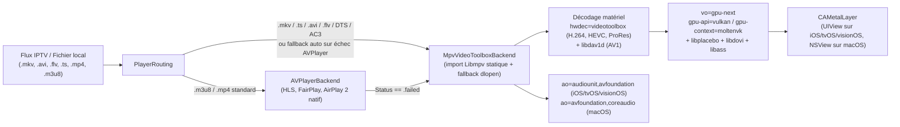

# PRD 35 — Lecture Native Universelle `.mkv` / `.avi` / `.ts` sur iOS, iPadOS, tvOS, visionOS & macOS (`MPVKit` LGPL + Metal Zero-Copy)

- **ID :** `PRD-35`
- **Prérequis :** `PRD-08` (Moteur vidéo hybride), `PRD-12` (PiP, AirPlay, Now Playing), `PRD-21` (tvOS), `PRD-22` (Live Activities & visionOS), `PRD-23` (Projet Xcode & signature), `PRD-32` (Bibliothèque média locale)
- **Couches impactées :**
  - `apple/project.yml` & `apple/Package.swift` *(liaison statique effective `MPVKit` LGPL sur les 4 plateformes + builds SwiftPM macOS)*
  - `apple/Sources/CndIptvKit/Player/MpvVideoToolboxBackend.swift` *(liaison C directe `import Libmpv`, rendu GPU `CAMetalLayer` + `vo=gpu-next` / `MoltenVK`, décodage matériel `VideoToolbox` zero-copy)*
  - `apple/Sources/CndIptvKit/Player/PlayerSurface.swift` *(surface `CAMetalLayer` multiplateforme `UIView` / `NSView`)*
  - `apple/Sources/CndIptvKit/Player/AudioSessionCoordinator.swift` *(nouveau : gestion `AVAudioSession` `.playback` / `.moviePlayback` sur iOS, tvOS et visionOS)*
  - `apple/Sources/CndIptvKit/Player/CndPlayerController.swift` *(cycle de vie arrière-plan GPU iOS/tvOS/visionOS, suppression du faux rejet `.mkv`)*
- **Objectifs SLA :**
  - Ouverture d'un film `.mkv` distant (1080p / 4K HEVC ou H.264, pistes AC3 / EAC3 / DTS / TrueHD / AAC, sous-titres SRT / ASS / PGS) en **< 1,5 s** sur Wi-Fi / 5G.
  - Décodage matériel `VideoToolbox` **Zero-Copy** : CPU **< 12 %** sur iPhone (A15+) et **< 8 %** sur Mac Apple Silicon en 4K HEVC HDR / Dolby Vision.
  - **Zéro crash GPU en arrière-plan** sur iOS / iPadOS / tvOS / visionOS lors du verrouillage de l'écran ou du changement d'application.
  - Conformité stricte **LGPLv2.1+** (variante `MPVKit` sans GPL, compatible App Store / TestFlight).

---

## 1. Diagnostic Technique : Pourquoi les `.mkv` échouaient malgré `MPVKit` ?

Lors des essais sur iPhone (`FR - Avengers : Infinity War (2018).mkv`), les journaux affichaient :

```text
INFO PLAYER — Ouverture de « FR - Avengers : Infinity War (2018) » (tv.konfatta.xyz, .mkv)
WARN PLAYER — mpv indisponible (libmpv introuvable ?) : utilisation de AVPlayer
ERROR PLAYER — Le format .mkv n'est pas pris en charge sur cet appareil (le moteur libmpv n'y est pas inclus)...
```

**Est-il possible de lire nativement les `.mkv` (distants IPTV et locaux) directement dans Buntu sur iOS, iPadOS, tvOS, visionOS et macOS sans VLC externe ?**
**OUI, à 100 %.** Mieux encore : toutes les bibliothèques nécessaires sont **déjà téléchargées par SwiftPM** via `MPVKit` (`1.1.0-n9.0.2`, licence LGPL), qui fournit des `XCFramework` compilés pour :
- `ios-arm64` (iPhone & iPad) et `ios-arm64_x86_64-simulator`
- `macos-arm64_x86_64` (Mac Apple Silicon & Intel)
- `tvos-arm64_arm64e` et `tvos-arm64_x86_64-simulator` (Apple TV 4K)
- `xros-arm64` et `xros-arm64-simulator` (Apple Vision Pro)

L'inspection binaire (`file`, `otool -L`, `nm`) de `CndIPTV.app` sur iOS a révélé **4 causes racines exactes** expliquant pourquoi `libmpv` n'était pas actif :

1. **Élimination au linkage (*Dead-Stripping*) de l'archive statique `Libmpv` :**
   `Libmpv.xcframework` dans `MPVKit` est une **archive statique (`current ar archive`, 3,0 Mo)** et non une bibliothèque dynamique `.dylib`. Or `MpvVideoToolboxBackend.swift` n'avait aucun `import Libmpv` et ne référençait aucun symbole C (`mpv_create`) à la compilation (il utilisait exclusivement `dlopen(nil, ...)` + `dlsym` à l'exécution). En l'absence de référence statique à la compilation, l'éditeur de liens Mach-O (`ld`) écarte **100 % des fichiers objets `.o`** de `Libmpv` et `FFmpeg` ! `dlsym` renvoyait donc systématiquement `NULL`.
2. **Absence de `MPVKit` dans `apple/Package.swift` :**
   Les builds macOS produits via `swift build` (`scripts/run-macos.sh`, `Buntu-macOS.zip`) ne dépendaient que de `CndCoreBridge`. Sur un Mac où `brew install mpv` n'est pas installé, `.mkv` échouait également.
3. **Pipeline de rendu logiciel (`sw`) inadapté à la 4K et au mobile :**
   `MpvRenderer` utilisait `MPV_RENDER_API_TYPE_SW` (`sw` → `bgr0` CPU → `CVPixelBuffer`), obligeant `VideoToolbox` à recopier chaque image décodée du GPU vers la RAM CPU (`videotoolbox-copy`). Or `MPVKit` embarque déjà `vo_gpu_next`, `libplacebo`, `MoltenVK`, `libdovi` (Dolby Vision) et `libdav1d` (AV1), permettant un rendu **100 % GPU Metal Zero-Copy** sur un `CAMetalLayer`.
4. **Absence de configuration `AVAudioSession` et de protection GPU arrière-plan sur iOS / tvOS / visionOS :**
   - Sur iOS, sans `AVAudioSession.Category.playback` (`mode: .moviePlayback`), le son est coupé si le bouton silencieux matériel de l'iPhone est enclenché, et le pilote `ao` optimal est `audiounit` (inclus dans `Libmpv.xcframework` : `audio_out_ao_audiounit.m.o`).
   - Sur iOS / tvOS / visionOS, le système tue immédiatement (`EXC_BAD_ACCESS` / GPU background kill) toute application qui soumet des buffers `Metal` / `MoltenVK` après le passage en arrière-plan si la piste vidéo `vid` n'est pas suspendue pendant la transition.

---

## 2. Architecture Cible Multiplateforme



### Matrice de prise en charge des formats après `PRD-35`

| Conteneur / Codec | iOS & iPadOS | tvOS (Apple TV) | visionOS | macOS (`.app` autonome) |
| :--- | :---: | :---: | :---: | :---: |
| **Conteneurs** `.mkv`, `.webm`, `.avi`, `.flv`, `.ts`, `.m2ts`, `.mpg` | Oui (natif) | Oui (natif) | Oui (natif) | Oui (natif, sans Homebrew) |
| **Vidéo** H.264, HEVC (10-bit), VP9, AV1 (`libdav1d`) | Oui (`VideoToolbox` / SIMD) | Oui (`VideoToolbox` / SIMD) | Oui (`VideoToolbox` / SIMD) | Oui (`VideoToolbox` / SIMD) |
| **HDR** HDR10, HLG, Dolby Vision (`libdovi` → tone-mapping / EDR) | Oui | Oui | Oui | Oui |
| **Audio** EAC3 (Dolby Digital+), AC3, DTS, DTS-HD, TrueHD, FLAC, Opus | Oui (décodage multicanal → PCM / Spatial) | Oui | Oui | Oui |
| **Sous-titres intégrés MKV** SRT, WebVTT, ASS/SSA stylisés (`libass`), PGS Blu-ray, VOBSUB | Oui | Oui | Oui | Oui |

---

## 3. Spécifications Techniques Détaillées

### 3.1. Liaison Statique Propre de `MPVKit` (LGPL) sur les 4 Plateformes

1. **Dépendance SPM unifiée (`apple/Package.swift` & `apple/project.yml`) :**
   - Ajouter `MPVKit` (`https://github.com/mpvkit/MPVKit.git`, version exacte `1.1.0-n9.0.2`, produit **LGPL** `MPVKit` — jamais `MPVKit-GPL`) comme dépendance de la cible **`CndIptvKit`** dans `apple/Package.swift` et `apple/project.yml`.
   - Dans `apple/project.yml`, retirer l'incorporation superflue de `Libmpv.framework` dans `Embed Frameworks` si Xcode tente de copier des squelettes statiques vides dans `PlugIns`/`Frameworks`, afin d'alléger et fiabiliser la signature sur iPhone gratuit (`Personal Team`).
2. **Pont C direct dans `MpvLibrary` (`MpvVideoToolboxBackend.swift`) :**
   - Ajouter `#if canImport(Libmpv) import Libmpv #endif` en tête de `MpvVideoToolboxBackend.swift`.
   - Lorsque `canImport(Libmpv)` est vrai (cas général Xcode + SwiftPM avec `MPVKit`), initialiser `MpvLibrary` en liant **directement** les pointeurs de fonctions C de `Libmpv` (`mpv_create`, `mpv_initialize`, `mpv_command`, `mpv_set_option_string`, `mpv_set_property_string`, `mpv_get_property_string`, `mpv_wait_event`, `mpv_terminate_destroy`, etc.). Cette référence directe à la compilation empêche `ld` d'éliminer l'archive statique !
   - Conserver le chargeur `dlopen` existant en compilation conditionnelle `#else` pour permettre des tests unitaires légers sans binaire vidéo si nécessaire.

### 3.2. Surface Vidéo GPU `CAMetalLayer` Zero-Copy (`vo=gpu-next` + `MoltenVK`)

Remplacer le rendu CPU `MPV_RENDER_API_TYPE_SW` par une vue hôte Metal dédiée (`MpvMetalLayerHost`) :

1. **Couche `CAMetalLayer` :**
   - Créer une sous-classe légère de `CAMetalLayer` (ou une vue hôte `UIView` / `NSView` dont `layerClass` / `makeBackingLayer()` est `CAMetalLayer`) :
     - `pixelFormat = .bgra8Unorm` (ou `.rgba16Float` avec `wantsExtendedDynamicRangeContent = true` lorsque l'écran supporte l'EDR / HDR sur iPhone Pro, iPad Pro, MacBook Pro, Apple TV 4K).
     - `framebufferOnly = true`
     - Synchronisation automatique de `drawableSize` avec `bounds.size * contentsScale` (`UIScreen` / `NSScreen` Retina) lors de chaque redimensionnement ou rotation d'écran (portrait ↔ paysage sur iPhone/iPad).
2. **Options `libmpv` optimisées :**
   - `wid = Int64(Int(bitPattern: Unmanaged.passUnretained(metalLayer).toOpaque()))` (pointeur vers le `CAMetalLayer`, pris en charge nativement par `video_out_vulkan_context_moltenvk.m` dans `MPVKit`).
   - `vo = "gpu-next"` (repli automatique sur `vo = "gpu"` en cas d'échec d'initialisation).
   - `gpu-api = "vulkan"`
   - `gpu-context = "moltenvk"`
   - `hwdec = "videotoolbox"` (zéro copie CPU ; repli `videotoolbox-copy` uniquement si un filtre vidéo logiciel l'exige).
   - `sub-auto = "fuzzy"`, rendu natif `libass` des sous-titres `.mkv` (SRT, ASS, PGS) à la résolution Retina du `CAMetalLayer`.
   - Maintien strict de la propagation HTTP : `user-agent`, `referrer`, `http-header-fields`, `tls-verify` et cache réseau (`demuxer-max-bytes = 64MiB` sur macOS/tvOS, `32MiB` sur iOS pour maîtriser l'empreinte RAM Jetsam).

### 3.3. Session Audio iOS / tvOS / visionOS (`AudioSessionCoordinator.swift`)

Créer un coordinateur `@MainActor` appelé à l'ouverture de tout flux (`AVPlayer` comme `mpv`) sur `#if os(iOS) || os(tvOS) || os(visionOS)` :
- Configurer `AVAudioSession.sharedInstance()` :
  ```swift
  try AVAudioSession.sharedInstance().setCategory(
      .playback,
      mode: .moviePlayback,
      policy: .longFormVideo
  )
  try AVAudioSession.sharedInstance().setActive(true)
  ```
- Configurer `mpv` avec :
  - `#if os(macOS)` → `option("ao", "avfoundation,coreaudio")`
  - `#else` → `option("ao", "audiounit,avfoundation")`
- Gérer les interruptions système (`AVAudioSession.interruptionNotification` : appel téléphonique entrant, Siri, alarme) et le débranchement d'écouteurs (`routeChangeNotification` `.oldDeviceUnavailable` → mise en pause automatique conformément aux HIG Apple).

### 3.4. Sécurité Arrière-Plan GPU sur iOS, tvOS & visionOS (Zéro Crash Metal)

Sur iOS, iPadOS, tvOS et visionOS, soumettre une frame `Metal` / `MoltenVK` lorsque l'application est en arrière-plan provoque la terminaison immédiate du processus par le noyau.

Dans `MpvVideoToolboxBackend` / `CndPlayerController` :
1. Observer `UIApplication.willResignActiveNotification` / `didEnterBackgroundNotification` :
   - Sur `didEnterBackgroundNotification` :
     - Si le mode « Audio en arrière-plan » est désactivé (défaut vidéo VOD) : mettre `mpv` en pause (`setProperty("pause", "yes")`) **et** désactiver temporairement le décodage vidéo (`savedVidTrack = property("vid")`, puis `setProperty("vid", "no")`) pour garantir zéro appel `MoltenVK` en tâche de fond.
     - Si le mode « Audio en arrière-plan » est activé (ex. chaîne musicale / direct) : couper uniquement la piste vidéo (`setProperty("vid", "no")`) afin que l'audio continue via `AVAudioSession` + `MPNowPlayingInfoCenter` !
2. Observer `UIApplication.willEnterForegroundNotification` / `didBecomeActiveNotification` :
   - Restaurer la piste vidéo (`setProperty("vid", savedVidTrack ?? "auto")`) dès le retour au premier plan et rafraîchir `drawableSize`.

### 3.5. Message d'Erreur & Bascule Transparente (`CndPlayerController`)

- Mettre à jour `PlayerRouting` pour que les extensions `.mkv`, `.webm`, `.avi`, `.flv`, `.ts`, `.m2ts`, `.divx`, `.wmv`, `.ogv` routent directement vers `.mpv` sur **toutes** les plateformes (macOS, iOS, iPadOS, tvOS, visionOS).
- Conserver la bascule automatique `AVPlayer` → `mpv` en `< 200 ms` lorsqu'un fichier `.mp4` ou un flux sans extension contient en réalité un conteneur Matroska, MPEG-TS ou une piste audio `AC3`/`DTS`/`EAC3` non décodable par `AVPlayer`.
- Conserver le menu « Ouvrir dans VLC / Infuse / IINA » uniquement comme choix volontaire de l'utilisateur, et retirer le message affirmant que `.mkv` n'est pas pris en charge sur l'appareil.

### 3.6. Option Complémentaire (Lot Optionnel 35.5) : Passerelle Remux Local pour AirPlay 2 Vidéo

`libmpv` couvre la lecture sur l'écran de l'appareil et l'**AirPlay Audio**, mais l'**AirPlay 2 Vidéo sans recopie d'écran** vers une Apple TV / Smart TV exige `AVPlayer` avec un flux HLS/fMP4.
- Si les codecs internes du `.mkv` sont déjà compatibles Apple (`H.264` ou `HEVC`), un serveur local éphémère sur `127.0.0.1:0` utilisant `FFmpeg` (`libavformat` déjà présent dans `MPVKit`, mode `-c:v copy` sans transcodage vidéo, transcodage léger audio `DTS/AC3 → AAC` uniquement si nécessaire) peut remuxer à la volée le `.mkv` en HLS fragmenté pour `AVPlayer` lorsque une route AirPlay Vidéo externe est détectée.

---

## 4. Découpage en Lots Exécutables

| Lot | Contenu | Validation principale |
| :--- | :--- | :--- |
| **35.1** | Liaison statique `import Libmpv` dans `MpvVideoToolboxBackend`, ajout de `MPVKit` dans `apple/Package.swift` + nettoyage `apple/project.yml`. Vérification par `nm` que `_mpv_create` est bien présent dans l'exécutable iOS, tvOS, visionOS et macOS. | `MpvLibrary.isAvailable == true` dans les tests unitaires sur macOS et iOS Simulator. |
| **35.2** | Surface `CAMetalLayer` multiplateforme (`UIView` / `NSView`) avec `vo=gpu-next`, `gpu-context=moltenvk`, `hwdec=videotoolbox`, gestion Retina/EDR et redimensionnement rotation portrait ↔ paysage. | Lecture fluide d'un film `.mkv` 1080p/4K HEVC avec sous-titres SRT/ASS sur Mac et iPhone. |
| **35.3** | `AudioSessionCoordinator` (`AVAudioSession` `.playback` / `.moviePlayback`, `ao=audiounit`, interruptions d'appels, débranchement AirPods) + cycle de vie GPU arrière-plan (`vid=no` en background, restauration au retour). | Son actif même iPhone en mode silencieux ; 0 crash lors du verrouillage écran ou switch d'app pendant un `.mkv`. |
| **35.4** | Polissage UX lecteur `.mkv` : sélection de pistes audio multiples (VF / VOST / Multi) et sous-titres internes MKV (`ASS`, `PGS`, `SRT`), reprise de position exacte, mise à jour des diagnostics d'erreur et tests automatisés. | Tests `CndPlayerTests` + builds Release des 4 plateformes (`macOS`, `iOS`, `tvOS`, `visionOS`) au vert. |
| **35.5** *(optionnel)* | Passerelle locale de remux `.mkv` → HLS fMP4 sans ré-encodage vidéo lors d'une diffusion AirPlay 2 Vidéo externe. | Diffusion d'un `.mkv` H.264/HEVC vers un récepteur AirPlay 2 sans mise en miroir d'écran. |

---

## 5. Fichiers à Créer / Modifier

- `apple/Package.swift` *(ajout du package `MPVKit` version `1.1.0-n9.0.2`, produit LGPL `MPVKit` sur `CndIptvKit`)*
- `apple/project.yml` *(vérification linkage `MPVKit` sur `CndIPTV-macOS`, `CndIPTV-iOS`, `CndIPTV-tvOS`, `CndIPTV-visionOS` sans copie de frameworks statiques fantômes)*
- `apple/Sources/CndIptvKit/Player/MpvVideoToolboxBackend.swift` *(`#if canImport(Libmpv) import Libmpv`, appels C directs, `CAMetalLayer` + `vo=gpu-next` + `moltenvk`, suspension `vid=no` en arrière-plan)*
- `apple/Sources/CndIptvKit/Player/PlayerSurface.swift` *(adaptation `UIViewRepresentable` / `NSViewRepresentable` pour redimensionner proprement `CAMetalLayer.drawableSize` à l'échelle Retina)*
- `apple/Sources/CndIptvKit/Player/AudioSessionCoordinator.swift` *(nouveau : `AVAudioSession`, interruptions et changements de route audio sur iOS/tvOS/visionOS)*
- `apple/Sources/CndIptvKit/Player/CndPlayerController.swift` *(observateurs cycle de vie scène/application, routage `.mkv` universel, messages d'erreur mis à jour)*
- `apple/Tests/CndIptvAppTests/MpvEngineAvailabilityTests.swift` *(nouveau : vérifie `MpvVideoToolboxBackend.isLibraryAvailable == true`, création/destruction propre d'un handle `mpv` hors-écran, routage `.mkv`/`.avi`/`.ts`)*
- `docs/BUILD_IPHONE.md` & `CHANGELOG.md` *(mise à jour : retrait de la mention d'incompatibilité `.mkv` sur iOS)*

---

## 6. Contraintes Non-Négociables (Guardrails IA)

1. **Licence LGPL stricte :** Toujours lier le produit `MPVKit` (LGPL) et **jamais** `MPVKit-GPL` (`Libmpv-GPL` / `Libsmbclient`).
2. **Zéro fuite mémoire / GPU :** `mpv_terminate_destroy` doit systématiquement être exécuté hors du thread de rendu et après détachement de la couche `CAMetalLayer` ; vérifier l'absence de fuite lors d'un zapping rapide de 20 fichiers `.mkv` consécutifs.
3. **Budget mémoire iOS (Jetsam) :** Sur iOS/tvOS/visionOS, plafonner `demuxer-max-bytes` à `32MiB` et `demuxer-max-back-bytes` à `16MiB` par défaut pour les VOD `.mkv` 4K afin de ne jamais déclencher un kill mémoire système.
4. **Protection GPU Background :** Aucune commande `MoltenVK` / `Metal` ne doit pouvoir s'exécuter une fois `UIApplication.didEnterBackgroundNotification` reçu.

---

## 7. Critères d'Acceptation & Validation

1. `nm -gU` sur le binaire compilé `CndIPTV` (macOS, iOS, tvOS, visionOS) confirme la présence effective de `_mpv_create` et `_ra_ctx_vulkan_moltenvk`.
2. `swift test` (macOS) et `xcodebuild test` (iOS Simulator) valident `MpvVideoToolboxBackend.isLibraryAvailable == true` et l'ouverture/fermeture sans fuite d'une instance `MpvVideoToolboxBackend`.
3. Lecture réelle sur iPhone (`icnd 14`) et sur Mac d'un film IPTV `.mkv` (`FR - Avengers : Infinity War (2018).mkv` et `FR: Avengers Endgame.mkv`) :
   - Ouverture directe en plein écran au clic sur **Lire** ;
   - Image fluide décodée par `VideoToolbox` (`hwdec-current == videotoolbox`), son synchronisé même bouton silencieux activé ;
   - Changement de piste audio (VF ↔ VO) et de sous-titres intégrés MKV fonctionnel ;
   - Mise en arrière-plan / verrouillage de l'iPhone puis retour dans l'application sans crash ni écran noir.

