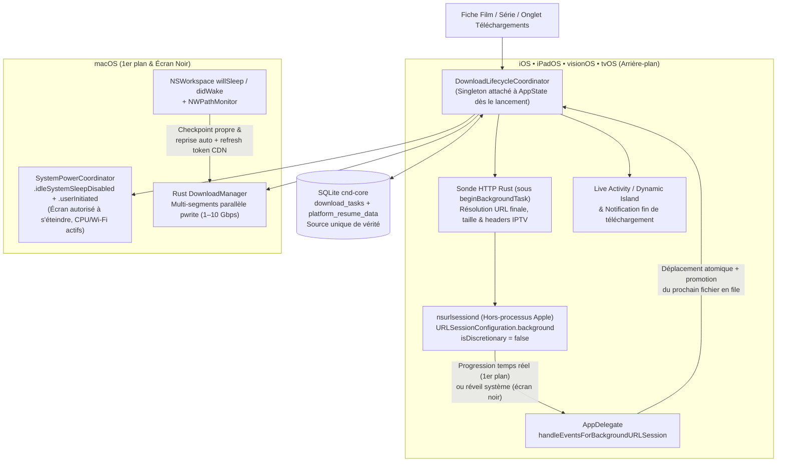

# PRD 36 — Continuité des Téléchargements Écran Éteint, Appareil Verrouillé & Mise en Veille (iOS, iPadOS, macOS, tvOS & visionOS)

- **ID :** `PRD-36`
- **Prérequis :** `PRD-07` (Moteur de téléchargement multi-segments), `PRD-11` (UI Téléchargements & Réglages), `PRD-21` (tvOS), `PRD-22` (Live Activities & visionOS), `PRD-23` (Projet Xcode & signature)
- **Couches impactées :**
  - `crates/cnd-core` (`db/schema.rs`, `db/download_repo.rs`, `downloader/mod.rs`, `downloader/worker.rs`, `lib.rs` — persistance `platform_resume_data`, pont d'état pour démon système externe, rafraîchissement automatique des tokens CDN expirés `HTTP 401/403/410`, suspension/reprise propre sur veille matérielle)
  - `apple/Sources/CndIptvKit/Features/Downloads/BackgroundDownloadCoordinator.swift` *(nouveau : exécution hors-processus via `URLSessionConfiguration.background` / `nsurlsessiond` sur iOS, iPadOS, visionOS & tvOS, chaînage de file d'attente écran éteint, repli `Range` sans `ETag`, protection `0xdead10cc`)*
  - `apple/Sources/CndIptvKit/Player/SystemPowerCoordinator.swift` *(évolution unifiée de `PlaybackSleepManager` : assertions d'énergie granulaires distinguant lecture vidéo et téléchargement actif sur macOS, tvOS et iOS)*
  - `apple/Sources/CndIptvApp/CndIptvApp.swift` & `apple/Sources/CndIptvKit/AppState.swift` *(`@UIApplicationDelegateAdaptor` pour `handleEventsForBackgroundURLSession`, cycle de vie global indépendant de l'onglet affiché, écoute veille/réveil `NSWorkspace` et réseau `NWPathMonitor`)*
  - `apple/Sources/CndIptvKit/Features/LiveActivities/` & `apple/LiveActivityExtension/` *(`DownloadActivityAttributes`, Dynamic Island / Écran verrouillé et notifications locales de fin de téléchargement)*
  - `apple/Resources/Info-iOS.plist`, `Info-tvOS.plist`, `Info-visionOS.plist` *(capacités arrière-plan & `BGTaskScheduler`)*
- **Objectifs SLA :**
  - **0 interruption** d'un téléchargement lorsqu'un iPhone/iPad est verrouillé (écran noir), qu'un utilisateur change d'application, qu'un Apple Vision Pro est posé ou que l'écran d'un Mac s'éteint.
  - **Chaînage autonome écran éteint :** Une saison complète mise en file d'attente (`N` épisodes avec `max_connections = 1`) se télécharge de bout en bout pendant que l'écran reste noir, sans nécessiter de déverrouiller l'appareil entre deux épisodes.
  - **Zéro terminaison noyau (`0xdead10cc` / `BackgroundTask` timeout)** lors du verrouillage d'un appareil protégé par code / Face ID / Touch ID.
  - **Reprise automatique `< 3 s`** après un basculement Wi-Fi ↔ 4G/5G ou à la réouverture du capot d'un MacBook sur batterie, y compris lorsque le jeton temporaire du CDN IPTV a expiré (`HTTP 401/403/410`).

---

## 1. Diagnostic Technique : Pourquoi les téléchargements s'arrêtaient sur écran noir ou veille ?

L'audit du code actuel (`crates/cnd-core/src/downloader/` et `apple/Sources/CndIptvKit/`) met en évidence **5 causes racines exactes** expliquant l'arrêt des téléchargements dès que l'écran devient noir ou que l'appareil entre en veille :

1. **Suspension du processus par le noyau iOS / iPadOS / visionOS (~5 secondes après extinction de l'écran) :**
   Tous les téléchargements s'exécutaient exclusivement dans les threads `tokio` *in-process* du moteur Rust (`reqwest`). Sur iOS/iPadOS/visionOS, dès que l'utilisateur verrouille l'écran ou quitte l'application (hors lecture audio active), `RunningBoard` **gèle l'intégralité du processus** après ~5 secondes. Les sockets TCP `reqwest` cessent d'envoyer des `ACK`, le serveur VOD IPTV ferme la connexion (`TCP RST` / timeout), et **0 octet** n'est transféré tant que l'écran reste noir.
2. **Absence d'assertion anti-veille système sur macOS (`idleSystemSleepDisabled`) :**
   `PlaybackSleepManager` ne maintenait le système éveillé que pendant la lecture vidéo, et `RecordingsModel` ne protégeait que les enregistrements PVR. Aucun jeton `ProcessInfo.beginActivity` n'était pris pour les téléchargements : sur un MacBook ou Mac de bureau, quelques minutes après l'extinction de l'écran (*Display Sleep*), macOS basculait en veille système profonde (*Idle System Sleep*), coupant le Wi-Fi et figeant `tokio`.
3. **Suivi des téléchargements couplé à la vue `DownloadsDashboardView` au lieu de `AppState` :**
   Dans `AppShellView.swift`, `DownloadsModel` ne démarrait sa boucle de suivi que dans `.task` de `DownloadsDashboardView` et l'arrêtait dans `.onDisappear`. Lancer le téléchargement d'un film depuis sa fiche détail sans ouvrir l'onglet *Téléchargements* laissait l'application sans coordinateur global actif.
4. **Verrous SQLite WAL & protection des fichiers sur appareil verrouillé (`0xdead10cc` / `EPERM`) :**
   Sur iOS, conserver un descripteur ouvert sur `cnd_iptv.db-wal` ou écrire dans `Documents/Downloads` pendant une transition vers l'arrière-plan ou lors d'un réveil écran verrouillé sans attribut `FileProtectionType.completeUntilFirstUserAuthentication` provoque soit une erreur POSIX `EPERM`, soit la terminaison immédiate du processus par le système (`0xdead10cc`).
5. **Expiration des jetons de redirection CDN IPTV (`HTTP 403`) et fenêtre de retry trop courte (`15,7 s`) :**
   Dans `worker.rs`, `MAX_RETRIES = 5` (backoff cumulé ~15,7 s) épuisait tous ses essais avant même que le Wi-Fi ne se réassocie au réveil d'une veille matérielle (ex. ouverture du capot d'un MacBook). De plus, un `HTTP 401/403/410` sur l'URL finale redirigée (`probe.final_url`) était traité comme une erreur fatale non-réessayable au lieu de re-sonder l'URL source (`row.url`) pour obtenir un nouveau jeton signé et reprendre au byte près.

---

## 2. Architecture Cible Multiplateforme



### Comportement garanti par plateforme

| Appareil / Plateforme | Écran noir / Verrouillé | Changement d'app | Veille matérielle forcée (ex. capot Mac fermé sur batterie) | Mécanisme natif utilisé |
| :--- | :---: | :---: | :---: | :--- |
| **iPhone & iPad (iOS / iPadOS 17+)** | Continue à 100 % | Continue à 100 % | Géré par `nsurlsessiond` | `URLSessionConfiguration.background` (`nsurlsessiond`) + `beginBackgroundTask` + `.completeUntilFirstUserAuthentication` |
| **Mac (macOS 14+)** | Continue à 100 % (écran éteint, Mac éveillé) | Continue à 100 % | Pause propre avant veille → Reprise auto au réveil | `ProcessInfo.beginActivity([.idleSystemSleepDisabled, .userInitiated])` + `NSWorkspace` sleep/wake |
| **Apple Vision Pro (visionOS)** | Continue à 100 % (casque posé) | Continue à 100 % | Géré par `nsurlsessiond` | `URLSessionConfiguration.background` + `beginBackgroundTask` |
| **Apple TV (tvOS 17+)** | Veille système différée jusqu'à fin du téléchargement | Continue via `nsurlsessiond` | Reprise auto au réveil | `isIdleTimerDisabled = true` pendant téléchargement actif + `URLSessionConfiguration.background` |

---

## 3. Spécifications Techniques Détaillées

### 3.1. Évolutions du Moteur Rust `cnd-core` & Schéma SQLite

1. **Migration SQLite additive (`crates/cnd-core/src/db/schema.rs`) :**
   Ajouter de manière idempotente sur la table `download_tasks` :
   - `driver TEXT NOT NULL DEFAULT 'rust'` (`'rust'` pour le moteur multi-segments POSIX, `'urlsession'` lorsque la tâche est déléguée à `nsurlsessiond` sur iOS/iPadOS/visionOS).
   - `platform_resume_data BLOB` (stocke le blob `resumeData` de `URLSessionDownloadTask` lors d'une mise en pause ou interruption).
   - `resume_on_wake INTEGER NOT NULL DEFAULT 0` (`1` lorsque la tâche a été suspendue automatiquement par une mise en veille matérielle forcée et non par un clic *Pause* de l'utilisateur).
2. **Pont de synchronisation UniFFI pour démon système (`crates/cnd-core/src/lib.rs`) :**
   Afin que `listDownloads`, `DownloadConnectionCoordinator`, les filtres UI, les compteurs et les journaux conservent **une seule source de vérité SQLite**, exposer sur `CndEngine` :
   - `claim_next_queued_for_platform(max_concurrent: u32) -> Result<Vec<DownloadPlatformTicket>, CndError>` *(réserve atomiquement les prochaines tâches `queued` pour `URLSession`, exécute ou fournit les métadonnées `url`, `user_agent`, `referer`, `headers_json`, `save_path`, `temp_path`, `downloaded_bytes`, `platform_resume_data`)*.
   - `probe_for_platform_download(task_id: i64) -> async Result<DownloadPlatformTicket, CndError>` *(exécute `probe_download_url` avec `HEAD` + fallback `GET Range: bytes=0-0` pour résoudre l'URL finale du CDN IPTV, la taille exacte et `accept_ranges`)*.
   - `update_platform_download_progress(task_id: i64, downloaded_bytes: u64, total_bytes: u64, speed_bps: f64, eta_seconds: u64, flush_db: bool) -> Result<(), CndError>` *(met à jour la vue temps réel lock-free en mémoire à 4 Hz et persiste en SQLite toutes les 2 s)*.
   - `save_platform_resume_data(task_id: i64, state: String, downloaded_bytes: u64, resume_data: Option<Vec<u8>>, error_message: Option<String>) -> Result<(), CndError>`.
   - `complete_platform_download(task_id: i64, final_size: u64) -> Result<(), CndError>`.
   - `suspend_downloads_for_system_sleep() -> async Result<u32, CndError>` et `resume_downloads_after_system_wake() -> async Result<u32, CndError>`.
3. **Rafraîchissement automatique des tokens CDN expirés & résilience réveil (`worker.rs` & `mod.rs`) :**
   - Lorsqu'un segment reçoit `HTTP 401`, `403` ou `410` (typique d'un jeton temporaire Xtream Codes / CDN expiré après 30 minutes ou au retour de veille) et que l'URL d'origine `row.url` diffère de `probe.final_url` : re-sonder `row.url` (1 fois par cycle avec verrou par tâche), mettre à jour `final_url` pour tous les segments restants et reprendre à `byte_start + progress` sans perdre un seul octet déjà écrit.
   - Étendre la politique de backoff réseau (`BACKOFF_MAX_MS = 15_000`, jusqu'à `8` tentatives soit ~60 s de tolérance aux coupures Wi-Fi ↔ cellulaire ou réassociation Wi-Fi post-veille).

### 3.2. Démon Hors-Processus iOS / iPadOS / visionOS (`BackgroundDownloadCoordinator`)

1. **Configuration `URLSession` système (`nsurlsessiond`) :**
   ```swift
   let config = URLSessionConfiguration.background(withIdentifier: "com.pcoundia.buntu.downloads.v1")
   config.isDiscretionary = false                  // Démarrage immédiat même sur batterie / écran verrouillé
   config.sessionSendsLaunchEvents = true          // Réveille Buntu en tâche de fond à la fin de chaque fichier
   config.waitsForConnectivity = true              // Attend automatiquement le retour Wi-Fi/5G sans échouer
   config.allowsCellularAccess = settings.allowsCellularDownloads
   config.allowsExpensiveNetworkAccess = settings.allowsCellularDownloads
   config.allowsConstrainedNetworkAccess = true
   config.httpMaximumConnectionsPerHost = max(1, connectionBudgetLimit)
   config.timeoutIntervalForResource = 60 * 60 * 12 // Jusqu'à 12 h pour les gros remux 4K sur connexion lente
   ```
   - Stocker `"cnd-task:\(taskId):offset:\(baseOffset)"` dans `downloadTask.taskDescription` pour reconstruire l'association exacte avec SQLite même après un redémarrage complet du processus par iOS (Jetsam).
   - Au démarrage de `AppState.attach(engine)`, appeler `session.getAllTasks` pour rattacher immédiatement les tâches `nsurlsessiond` qui ont continué de tourner pendant que l'application était fermée ou suspendue !
2. **Gestion de la particularité des serveurs IPTV sans `ETag` (Reprise universelle garantie) :**
   - `URLSessionDownloadTask.cancel(byProducingResumeData:)` ne produit un `resumeData` Apple que si le serveur HTTP envoie `ETag` ou `Last-Modified`. Or de nombreux serveurs Xtream Codes n'envoient que `Accept-Ranges: bytes` sans `ETag`.
   - **Solution hybride sans faille :**
     1. Tenter `cancel(byProducingResumeData:)`. Si `resumeData != nil`, le persister dans `platform_resume_data`.
     2. Si `resumeData == nil` mais que des octets ont déjà été téléchargés dans `<save_path>.part` et que `accept_ranges == true` : lors de la reprise, lancer une `URLSessionDownloadTask` avec l'en-tête explicite `Range: bytes=<existingPartSize>-` (après rafraîchissement de l'URL finale via le `Prober` Rust !). À la réception du fichier temporaire de `didFinishDownloadingTo:`, si `baseOffset > 0` et `HTTP 206`, concaténer par chunks de `4 Mo` (`FileHandle` streaming, **zéro chargement en RAM**) à la suite de `<save_path>.part`, puis renommer atomiquement vers `<save_path>`.
3. **Chaînage autonome d'une saison entière écran noir (`AppDelegate` + `beginBackgroundTask`) :**
   - Ajouter `@UIApplicationDelegateAdaptor(IosAppDelegate.self)` dans `CndIptvApp.swift` pour `#if os(iOS) || os(visionOS) || os(tvOS)`.
   - Implémenter `application(_:handleEventsForBackgroundURLSession:completionHandler:)` :
     - Dans `urlSession(_:downloadTask:didFinishDownloadingTo:)`, déplacer **de façon synchrone** (exigence Apple avant le retour du délégué) le fichier reçu vers `<save_path>.part` / `<save_path>`.
     - Avant d'invoquer `urlSessionDidFinishEvents`'s `completionHandler()`, acquérir `UIApplication.shared.beginBackgroundTask(withName: "BuntuQueuePromote")`, marquer la tâche `completed` dans `CndEngine`, vérifier s'il reste une tâche `queued` (ex. Épisode 2, 3, 4…), exécuter sa sonde HTTP et soumettre immédiatement la nouvelle `URLSessionDownloadTask` à `nsurlsessiond`, puis appeler `completionHandler()` et terminer la `BackgroundTask`.
4. **Élimination radicale des crashs `0xdead10cc` (Protection Fichiers & SQLite) :**
   - Dès la création de `Application Support/CndIptvNative` (base SQLite + fichiers `-wal` / `-shm`) et de `Documents/Downloads`, appliquer l'attribut POSIX/NSFileManager :
     `FileAttributeKey.protectionKey: FileProtectionType.completeUntilFirstUserAuthentication`.
   - Sur `UIApplication.didEnterBackgroundNotification`, acquérir un `beginBackgroundTask` court pour vider proprement tout tampon SQLite (`PRAGMA wal_checkpoint(PASSIVE)`) et suspendre le polling UI `@MainActor` (`0 % CPU`).

### 3.3. Coordinateur d'Énergie Système (`SystemPowerCoordinator`)

Faire évoluer `PlaybackSleepManager` (en conservant 100 % de sa compatibilité ascendante et de ses tests existants) pour gérer deux niveaux d'assertions indépendants :

1. **Niveau `displayAndSystem` (Lecture vidéo active) :**
   - **macOS :** `ProcessInfo.processInfo.beginActivity(options: [.idleDisplaySleepDisabled, .idleSystemSleepDisabled, .userInitiated], reason: "Lecture vidéo Buntu")`
   - **iOS / tvOS / visionOS :** `UIApplication.shared.isIdleTimerDisabled = true`
2. **Niveau `systemOnly` (Téléchargement ou enregistrement actif, sans vidéo en cours) :**
   - **macOS :** `ProcessInfo.processInfo.beginActivity(options: [.idleSystemSleepDisabled, .userInitiated], reason: "Téléchargement média Buntu en cours")`
     → **L'écran du Mac s'éteint normalement** selon les réglages système de l'utilisateur (écran noir, économie OLED/Mini-LED), mais **le processeur, le disque et le Wi-Fi restent actifs** jusqu'à ce que la file de téléchargements soit terminée ou mise en pause !
   - **macOS (Veille matérielle forcée : fermeture du capot sur batterie) :**
     Observer `NSWorkspace.shared.notificationCenter` (`willSleepNotification` / `didWakeNotification`) :
     - Sur `willSleepNotification` : appeler `await engine.suspendDownloadsForSystemSleep()` pour vider les tampons `pwrite` et enregistrer `resume_on_wake = 1` sans déclencher d'erreur réseau.
     - Sur `didWakeNotification` : attendre que `NWPathMonitor` signale `.satisfied` (ou délai max 3 s) puis appeler `await engine.resumeDownloadsAfterSystemWake()`.
   - **tvOS :** Activer `UIApplication.shared.isIdleTimerDisabled = true` tant qu'un téléchargement est actif afin d'empêcher l'Apple TV de couper le réseau par mise en veille CEC automatique au bout de 15 minutes.
   - **iOS / iPadOS :** Laisser `isIdleTimerDisabled = false` par défaut (car `nsurlsessiond` télécharge écran totalement éteint avec une consommation batterie minimale), sauf si l'utilisateur active explicitement l'option *« Garder l'écran allumé pendant les téléchargements »* dans les Réglages.

### 3.4. Suivi Écran Verrouillé, Dynamic Island & Notifications

1. **Live Activity de Téléchargement (`DownloadActivityAttributes` dans `LiveActivityAttributes.swift` & `LiveActivityBundle.swift`) :**
   - Attributs statiques / dynamiques strictement anonymisés (**jamais d'URL ni d'identifiants IPTV**) : titre du média principal, nombre de tâches restantes (`ex. "Avengers Endgame (+2 en file)"`), fraction globale `0.0...1.0`, octets téléchargés / attendus, vitesse formatée.
   - Mise à jour throttlée à **au maximum 1 mise à jour toutes les 30 secondes** (ou lors du passage d'un épisode au suivant / complétion) pour respecter le budget ActivityKit d'iOS.
   - Action interactive `PauseAllDownloadsIntent` depuis l'écran verrouillé / Dynamic Island.
2. **Notification locale de fin (`UNUserNotificationCenter`) :**
   - Demander l'autorisation de manière non-intrusive lors du premier téléchargement lancé en arrière-plan (si l'option est activée).
   - Lorsque la file se termine alors que l'application est en arrière-plan / écran éteint, publier une notification locale : *« Téléchargement terminé — Avengers Endgame est prêt hors-ligne »* (ou *« 4 épisodes téléchargés »* pour un lot).

### 3.5. Nouveaux Réglages Utilisateur (`SettingsView` > Téléchargements)

Ajouter dans la section **Téléchargements** de `SettingsView.swift` :
- **Continuer écran éteint / en arrière-plan** (`Bool`, défaut : `true`)
- **Autoriser les téléchargements via réseau cellulaire (4G/5G)** (`Bool`, défaut : `true`, affiché sur iOS/iPadOS)
- **Notification à la fin du téléchargement** (`Bool`, défaut : `true`)
- **Garder l'écran allumé pendant un téléchargement** (`Bool`, défaut : `false` sur iOS/iPadOS)

---

## 4. Découpage en Lots Exécutables

| Lot | Contenu | Validation principale |
| :--- | :--- | :--- |
| **36.1** | **Socle Rust `cnd-core` & Résilience Réseau/Veille :** Migration SQLite (`driver`, `platform_resume_data`, `resume_on_wake`), rafraîchissement automatique du token CDN sur `HTTP 401/403/410` dans `worker.rs`, backoff étendu post-veille, fonctions FFI UniFFI de pont `platform_download` et `suspend/resume_for_system_sleep` + `./scripts/build-xcframework.sh`. | Tests Rust (`cargo test`) : simulation d'expiration de token CDN `403` à 50 % d'un fichier multi-segments + reprise sans perte et vérification du hash `blake3`. |
| **36.2** | **Énergie Système & Coordinateur Global (`AppState` + macOS + tvOS) :** Création de `SystemPowerCoordinator` (assertion `.idleSystemSleepDisabled` sans bloquer l'extinction d'écran sur macOS, `NSWorkspace` sleep/wake + `NWPathMonitor`, prévention veille tvOS) et remontée du cycle de vie des téléchargements dans `AppState` (actif même hors de l'onglet *Téléchargements*). | Tests unitaires Swift sur les assertions d'énergie (`video` vs `download` vs repos) et reprise automatique après événement `willSleep`/`didWake` simulé. |
| **36.3** | **Démon Hors-Processus iOS / iPadOS / visionOS (`BackgroundDownloadCoordinator`) :** Session `URLSessionConfiguration.background`, `IosAppDelegate` (`handleEventsForBackgroundURLSession`), protection `.completeUntilFirstUserAuthentication` anti-`0xdead10cc`, reprise hybride `resumeData` + repli `Range` pour serveurs IPTV sans `ETag`, chaînage automatique des épisodes en file d'attente écran éteint, respect de `DownloadConnectionCoordinator`. | Téléchargement complet sur iPhone verrouillé (écran noir) d'un film VOD et d'une file de 2 épisodes consécutifs, plus pause/reprise et reconnexion au relancement de l'app. |
| **36.4** | **UX Écran Verrouillé & Réglages :** `DownloadLiveActivity` (Dynamic Island + Lock Screen throttlé, `PauseAllDownloadsIntent`), notification locale de fin de téléchargement, bascules dans `SettingsView` (cellulaire, notifications, écran éveillé) et validation des 4 cibles Xcode. | Compilation sans warning des 4 schémas (`macOS`, `iOS`, `tvOS`, `visionOS`) + suite de tests `DownloadsUiTests` et `BackgroundDownloadTests` à 100 %. |

---

## 5. Fichiers à Créer / Modifier

- `crates/cnd-core/src/db/schema.rs` & `crates/cnd-core/src/db/download_repo.rs` *(colonnes `driver`, `platform_resume_data`, `resume_on_wake` et requêtes associées)*
- `crates/cnd-core/src/downloader/mod.rs` & `crates/cnd-core/src/downloader/worker.rs` *(pont `platform_download`, re-probe auto sur `401/403/410`, gestion `suspend_for_system_sleep` / `resume_after_system_wake`)*
- `crates/cnd-core/src/lib.rs` *(exports UniFFI)*
- `apple/Sources/CndIptvKit/Player/PlaybackSleepManager.swift` *(extension ou délégation vers `SystemPowerCoordinator` avec domaines `.playback` et `.backgroundTransfer`)*
- `apple/Sources/CndIptvKit/Features/Downloads/BackgroundDownloadCoordinator.swift` *(nouveau : pilote `URLSessionConfiguration.background`, rattachement au lancement, chaînage de file écran éteint, repli `Range`)*
- `apple/Sources/CndIptvKit/Features/Downloads/DownloadsModel.swift` *(connexion au coordinateur global de `AppState`, arrêt propre du timer UI en arrière-plan)*
- `apple/Sources/CndIptvKit/AppState.swift` & `apple/Sources/CndIptvKit/App/AppShellView.swift` *(attachement global dès l'ouverture de `CndEngine`, notifications `VodContext` → coordinateur, protection `.completeUntilFirstUserAuthentication`)*
- `apple/Sources/CndIptvApp/CndIptvApp.swift` *(`IosAppDelegate` avec `handleEventsForBackgroundURLSession`)*
- `apple/Sources/CndIptvKit/Features/LiveActivities/LiveActivityAttributes.swift`, `LiveActivityManager.swift`, `LiveActivityIntents.swift` & `apple/LiveActivityExtension/LiveActivityBundle.swift` *(`DownloadActivityAttributes` + widget Dynamic Island / Lock Screen)*
- `apple/Sources/CndIptvKit/Features/Settings/SettingsView.swift` *(réglages arrière-plan, cellulaire, notifications, maintien d'écran)*
- `apple/Resources/Info-iOS.plist`, `Info-tvOS.plist`, `Info-visionOS.plist` *(`UIBackgroundModes` : `audio`, `fetch`, `processing`)*
- `apple/Tests/CndIptvAppTests/BackgroundDownloadTests.swift` *(nouveau : tests unitaires de coordination, reprise sans `ETag`, assertions d'énergie et chaînage de file)*

---

## 6. Contraintes Non-Négociables (Guardrails IA)

1. **Conformité App Store stricte (Zéro hack audio muet) :** Il est formellement interdit de jouer une piste audio silencieuse en boucle pour maintenir l'app active en arrière-plan (motif de rejet immédiat App Store Guideline 2.5.4). Utiliser exclusivement `URLSessionConfiguration.background`, `beginBackgroundTask` et `BGTaskScheduler`.
2. **Respect absolu du `ConnectionBudget` IPTV :** Lorsque l'abonnement IPTV n'autorise qu'une connexion (`limit == 1`), `BackgroundDownloadCoordinator` doit obéir à `DownloadConnectionCoordinator` (suspendre le téléchargement si l'utilisateur lance un direct sur le même hôte, et ne lancer qu'un fichier à la fois avec `httpMaximumConnectionsPerHost = 1`).
3. **Zéro chargement de fichier média en mémoire (Anti-OOM / Jetsam) :** Lors d'une reprise `Range` par concaténation sur un fichier `.mkv` / `.mp4` de plusieurs gigaoctets, copier par blocs de `4 Mo` maximum via `FileHandle` — ne jamais appeler `Data(contentsOf:)` sur un fichier vidéo.
4. **Confidentialité écran verrouillé :** Aucun jeton, mot de passe Xtream ni URL de flux ne doit figurer dans `DownloadActivityAttributes`, `taskDescription` ou le texte des notifications locales.
5. **Zéro Timer actif au repos :** Dès que `ScenePhase == .background` ou qu'aucun téléchargement n'est actif, le polling UI `@MainActor` (`250 ms`) doit être arrêté (`0 % CPU`).

---

## 7. Critères d'Acceptation & Validation

1. **Test iPhone / iPad écran éteint :** Lancer le téléchargement d'un film VOD (`.mp4` ou `.mkv` > 1 Go) depuis la fiche Film, verrouiller immédiatement l'iPhone (bouton latéral → écran noir) pendant 5 minutes : au déverrouillage (ou sur la Live Activity de l'écran verrouillé), le téléchargement a progressé à pleine vitesse sans coupure ni erreur, et s'achève proprement dans `Fichiers > Sur mon iPhone > Buntu > Downloads`.
2. **Test Saison multi-épisodes écran noir :** Mettre en file d'attente 3 épisodes avec `max_connections = 1`, verrouiller l'iPhone : le 1er épisode se termine écran éteint et déclenche automatiquement le 2e puis le 3e sans déverrouiller l'appareil.
3. **Test Mac écran noir :** Lancer un téléchargement multi-segments sur macOS, éteindre l'écran (`⌃⇧Éject` / coin actif *Mettre le moniteur en veille* / verrouillage écran `⌃⌘Q`) : `pmset -g assertions` affiche `PreventUserIdleSystemSleep = 1` pour `Buntu` (sans `PreventUserIdleDisplaySleep`), l'écran reste noir et le téléchargement sature la bande passante jusqu'à complétion, puis relâche immédiatement l'assertion.
4. **Test Expiration de Token CDN & Coupure Réseau :** En test automatisé Rust (`cargo test`) et Swift (`swift test`), un serveur HTTP local qui invalide son URL redirigée (`403 Forbidden`) après 50 % des octets provoque un nouveau `probe` sur l'URL source et termine le fichier avec un hash `blake3` identique à l'original.
5. **Validation CI complète :**
   ```bash
   cargo test --workspace
   cargo clippy --workspace -- -D warnings
   ./scripts/build-xcframework.sh
   cd apple && swift test
   ```
   et compilation réussie des 4 schémas Xcode (`CndIPTV-macOS`, `CndIPTV-iOS`, `CndIPTV-tvOS`, `CndIPTV-visionOS`).

