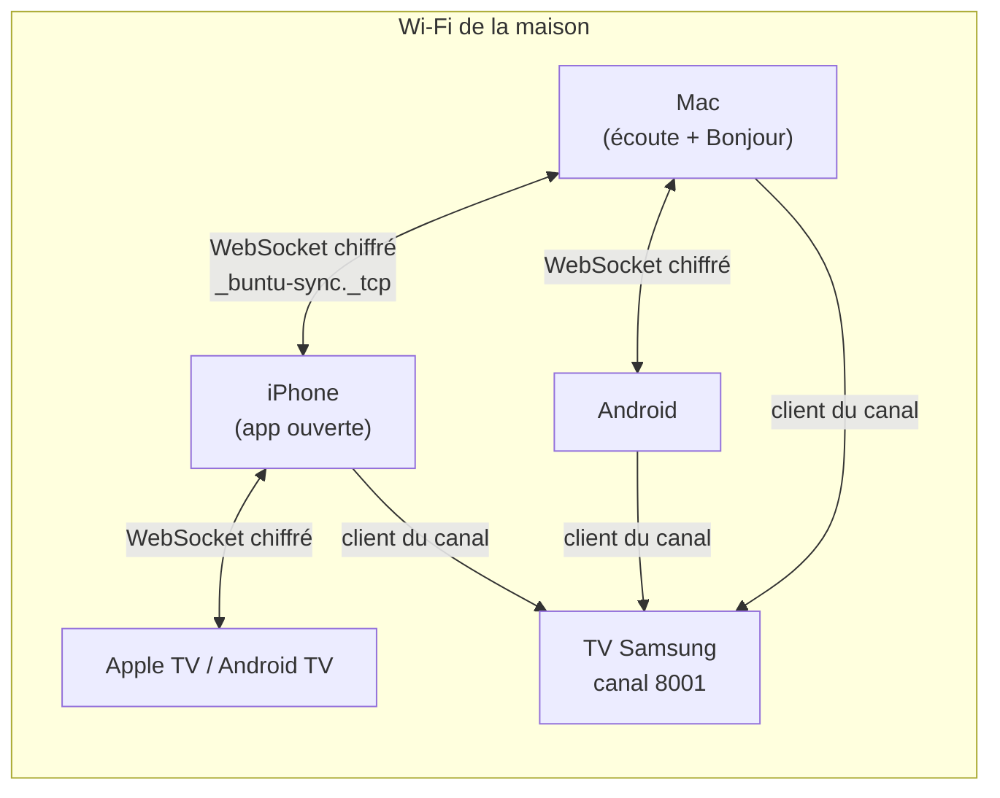

# PRD 41 — Continuité entre les apps Buntu (Mac, iPhone/iPad, Apple TV, Android, Samsung) sur le Wi-Fi de la maison, sans serveur

- **ID :** `PRD-41`
- **Prérequis :**
  - `PRD-12` (synchronisation iCloud des appareils Apple : `SyncDelta`, `CKSyncEngine`) ;
  - `PRD-20` (profils, mode Enfants) et `PRD-26` (document de partage des sources) ;
  - `PRD-37` (Android), `PRD-21` (Apple TV), `PRD-38` (Samsung Tizen) ;
  - `PRD-39` (appairage par QR code chiffré de bout en bout, canal Samsung).
- **Couches impactées :**
  - `Rust` : identité des contenus et module **`sync`** dans `cnd-domain` (enregistrements, horloge, fusion, chiffrement des messages), sans entrées-sorties, compilé pour UniFFI (Swift, Kotlin) et WebAssembly (Tizen) ; `cnd-core/src/db/sync_repo.rs` étendu ;
  - `apple/` : Bonjour, WebSocket local, Trousseau, écrans « Appareils de la maison » et reprise ;
  - `android/` : `NsdManager`, WebSocket local, Keystore, mêmes écrans ;
  - `tizen/` : client du canal Samsung, stockage IndexedDB, mêmes écrans, réception de « Regarder sur la TV ».
- **Objectifs SLA :**
  - **< 5 s** entre un changement (favori, position) et sa présence sur un autre appareil ouvert du foyer, sur le même Wi-Fi ;
  - reprise d'un film sur un autre appareil **à ± 15 s** de l'endroit quitté ;
  - « Regarder sur la TV » : **< 10 s** jusqu'à l'image, app de la TV déjà ouverte ;
  - **0 donnée lisible** sur le réseau local (capture réseau), **0 mot de passe** dans les journaux.

---

## 1. Contexte & Objectif

L'utilisateur a plusieurs Buntu : Mac, iPhone/iPad, Apple TV, Android (téléphone et TV) et la TV Samsung. Aujourd'hui, chacun vit seul : un favori, une position de lecture ou un compte ajouté sur un appareil n'existe pas sur les autres (sauf entre appareils Apple, par iCloud, avec un compte développeur payant).

**Objectif :** retrouver d'un appareil à l'autre :
1. **la reprise de lecture** (films, épisodes, dernière chaîne) ;
2. **les favoris, les récents et les profils** ;
3. **les comptes IPTV**, mots de passe compris ;
4. **« Regarder sur la TV »** depuis le téléphone ou le Mac, et la télécommande depuis le téléphone.

### 1.1. Choix de l'utilisateur

| Question | Réponse | Conséquence |
| :--- | :--- | :--- |
| Que retrouver ? | Les quatre familles ci-dessus | Données au § 4, reprise au § 7, envoi vers la TV au § 8. |
| Où ? | **Même Wi-Fi seulement** | Pas de relais Internet ; découverte et échange en réseau local. |
| Serveur ? | **Aucun** | Synchronisation d'appareil à appareil ; la TV Samsung sert de point de rendez-vous quand elle est allumée. |
| Pour qui ? | **Moi et ma famille** | Pas de compte utilisateur : un **foyer** d'appareils reliés par QR code. |

### 1.2. Ce qui existe déjà

| Brique | Où | Utilité |
| :--- | :--- | :--- |
| **Delta de synchronisation** (`SyncDelta` : profils, sources, favoris, progression, suppressions), export « depuis une date » et import | `crates/cnd-core/src/db/sync_repo.rs` ; exposé à Swift et Kotlin (`export_sync_delta`, `import_sync_delta`) | Le format des changements existe ; à étendre (récents, dernière chaîne) et à rendre indépendant de SQLite pour Tizen. |
| **Synchronisation iCloud** des sources, favoris et progressions | `apple/Sources/CndIptvKit/Sync/` (`PRD-12`) | Appareils Apple seulement. |
| **Appairage par QR code** (X25519, HKDF, AES-256-GCM, confirmation à la télécommande) | `crates/cnd-domain/src/pairing.rs` (`PRD-39`), Swift, Kotlin, WebAssembly | Base pour rejoindre le foyer. |
| **Document de partage des sources** (sans doublons à l'import) | `crates/cnd-core/src/sharing/` (`PRD-26`) | Format des comptes IPTV transférés. |
| **Canal Samsung** `ws://<tv>:8001/api/v2/channels/<nom>`, qui relaie entre clients (vérifié jusqu'à 60 Ko) | `tizen/src/core/pairing/MsfChannel.ts` | Point de rendez-vous local quand la TV est allumée. |
| **Récemment vus, dernière chaîne, liste de zapping** | Tizen (`ZapContext`, reprise de la dernière chaîne au démarrage) | Données à rendre synchronisables. |

### 1.3. Hors périmètre

- Synchronisation **hors de la maison** (pas de relais Internet, par choix).
- Synchroniser le **catalogue** (chaînes, films, guide) : chaque appareil le télécharge lui-même, comme aujourd'hui (règle du `PRD-12`).
- Comptes utilisateurs et partage entre foyers.

---

## 2. Expérience utilisateur

- **Réglages > Appareils de la maison :** créer le foyer, « Ajouter un appareil » (QR code), liste des appareils (nom, type, dernière synchronisation), « Retirer », état de la synchronisation.
- **Reprise :** rangée « Reprendre » en tête de Films et Séries avec les lectures de tous les appareils ; à l'ouverture d'un film commencé ailleurs : « Reprendre à 42:10 (regardé sur le Mac) » ; au démarrage, une bannière discrète : « Vous regardiez *X* sur l'iPhone il y a 10 min — Reprendre ? ».
- **Direct :** la dernière chaîne regardée sur n'importe quel appareil du foyer devient la chaîne de reprise.
- **« Regarder sur la TV »** dans le lecteur et le mini lecteur des téléphones et du Mac : choix de la TV, puis la lecture passe sur la TV à la même position.
- **Télécommande** depuis le téléphone : flèches, OK, retour, saisie de texte (utile pour la recherche par IA du `PRD-40`).
- **Message clair** quand le réseau isole les appareils (Wi-Fi invité, isolation des clients sur la box).

---

## 3. Identité commune des contenus (verrou n° 1)

Une position ou un favori est rattaché à un **`stable_hash`**. Il doit désigner la même chaîne sur tous les appareils. Ce n'est pas le cas aujourd'hui :

| Contenu | Cœur Rust (Mac, iPhone, Apple TV, Android) | TV Samsung (Tizen) |
| :--- | :--- | :--- |
| Chaîne Xtream | `blake3("<uuid de la source>:xtream_live:<stream_id>")` | `live_<stream_id>` |
| Film Xtream | `blake3("<uuid de la source>:…:<stream_id>")` | `vod_<stream_id>` |
| Série Xtream | `series:` + `blake3("<uuid de la source>:<clé canonique>")` | `series_<series_id>` |
| Élément M3U | `blake3("<uuid de la source>:<URL nettoyée>")` | idem (même code Rust en WebAssembly) |

**Deux défauts :** les formats Xtream diffèrent entre Tizen et le cœur ; et l'`uuid` de la source est **aléatoire** : le même compte ajouté séparément sur deux appareils (même deux appareils Apple) donne des identifiants différents pour toutes ses chaînes.

**Règles :**
- **Identité de source déterministe :** `source_key = blake3(serveur normalisé | nom d'utilisateur)` pour Xtream ; `blake3(URL de playlist normalisée sans les paramètres d'identification)` pour M3U. Le mot de passe n'y entre pas.
- **Identité de contenu :** `content_key = blake3(source_key | type | identifiant du fournisseur)`, calculée par **une seule fonction Rust** dans `cnd-domain`, utilisée par le cœur et par Tizen.
- **Migration :** chaque appareil recalcule les clés de ses éléments et convertit favoris, progressions et récents, une seule fois. L'ancien `stable_hash` est gardé le temps de la migration.
- **Effet de bord utile :** le même compte ajouté deux fois est reconnu comme un seul (fin des doublons de sources).

---

## 4. Données synchronisées

| Donnée | Taille typique | Conflit | Remarques |
| :--- | :--- | :--- | :--- |
| **Comptes IPTV** | quelques Ko | Le plus récent gagne, champ par champ ; suppression = pierre tombale | **Mots de passe compris**, chiffrés de bout en bout ; rangés dans le Trousseau (Apple), le Keystore (Android), le stockage chiffré WebCrypto de la TV (comme au `PRD-40 § 4.3`). |
| **Profils** (nom, avatar, Enfants, restrictions) | < 1 Ko | Le plus récent gagne | Un profil Enfants reste Enfants partout. |
| **Favoris** | < 50 Ko | Ajout / retrait daté ; le plus récent gagne | Par profil. |
| **Progression** (films, épisodes) | < 200 Ko | `last_watched_at` le plus récent gagne | Envoyée toutes les 15 s pendant la lecture, et à la pause, à l'arrêt, à la fin. |
| **Récemment vus** (TV, films, séries) | < 20 Ko | Fusion par date ; 50 par type | Par profil. |
| **Dernière chaîne regardée** | < 1 Ko | La plus récente gagne | Par profil. |

**Horloge :** les dates de conflit utilisent une **horloge logique hybride** (heure de l'appareil corrigée par les dates reçues), pour qu'un appareil en retard de quelques minutes n'écrase pas un changement plus récent.

**État complet sur chaque appareil :** chaque appareil garde l'état du foyer (quelques centaines de Ko). Il n'y a **pas de maître** : deux appareils qui se voient échangent les changements que l'autre n'a pas, et l'état converge.

---

## 5. Le foyer : confiance et clés

- **Créer le foyer :** une seule fois, sur n'importe quel appareil. Il produit une **clé de foyer** aléatoire de 256 bits.
- **Ajouter un appareil :** QR code et échange chiffré du `PRD-39`, avec un nouveau type de message `household-join` qui transporte la clé du foyer. **Confirmation à l'écran** (à la télécommande sur une TV). Le détail, dans les deux sens (le nouvel appareil scanne, ou l'inverse), est au [`PRD-43`](./43_AJOUTER_UN_APPAREIL_PAR_QR_CODE.md).
- **Messages :** chiffrés et authentifiés avec la clé du foyer (AES-256-GCM), avec un compteur anti-rejeu. Un appareil du réseau hors du foyer, ou le canal Samsung qui relaie, ne peut ni lire ni modifier.
- **Retirer un appareil** (perdu, vendu) : depuis un autre appareil, « Retirer » **change la clé du foyer** ; les autres la reçoivent au prochain échange, l'appareil retiré ne lit plus rien.
- **Clé du foyer** rangée dans le coffre de chaque plateforme ; jamais affichée, jamais dans les journaux ni dans un export.

---

## 6. Transport local, sans serveur

### 6.1. Ce que chaque plateforme sait faire

| Plateforme | Écouter (serveur local) | Trouver les autres (Bonjour) | En arrière-plan | Coffre à secrets |
| :--- | :--- | :--- | :--- | :--- |
| **Mac** | oui | oui | oui | Trousseau |
| **iPhone / iPad** | oui, app ouverte | oui (autorisation « Réseau local ») | non, sauf brièvement | Trousseau |
| **Apple TV** | oui, app ouverte | oui | non | Trousseau |
| **Android (téléphone)** | oui, app ouverte | oui (`NsdManager`) | limité | Keystore |
| **Android TV** | oui (service de premier plan possible) | oui | oui, si le service tourne | Keystore |
| **Samsung (Tizen)** | **non** (une app web ne peut pas ouvrir de port) | **non** pour l'app ; mais **la TV s'annonce elle-même** (§ 9) | non (l'app ne tourne qu'ouverte) | aucun ; chiffrement WebCrypto |

### 6.2. Deux chemins, un seul format

1. **Entre les appareils qui peuvent écouter** (Mac, iPhone et Apple TV app ouverte, Android, Android TV) : service Bonjour `_buntu-sync._tcp` et connexions WebSocket, sans saisie d'adresse.
2. **Avec la TV Samsung :** la TV s'annonce (`_samsungmsf._tcp`). Les autres appareils **et l'app Buntu de la TV** se connectent comme **clients** au canal `ws://<tv>:8001/api/v2/channels/buntu.sync.<identifiant du foyer>`, que la TV relaie. C'est le seul chemin possible pour la TV Samsung ; il ne marche que TV allumée.

**Format unique :** des deltas (changements depuis le dernier échange avec cet appareil), chiffrés avec la clé du foyer. Fusion, horloge, chiffrement et validation sont en **Rust (`cnd-domain::sync`)**, utilisés par toutes les apps.

### 6.3. Quand ça synchronise

- à l'ouverture de l'app, à chaque changement (après 2 s sans autre changement), toutes les minutes tant que l'app est ouverte ;
- pendant une lecture : la position toutes les 15 s et à la pause ou à l'arrêt ;
- un appareil éteint ou hors de la maison rattrape au prochain passage sur le Wi-Fi.

---

## 7. Reprendre la lecture

- **Films et séries :** la position du foyer est proposée à l'ouverture ; la rangée « Reprendre » rassemble les lectures de tous les appareils.
- **Direct :** la TV Samsung relance déjà la dernière chaîne au démarrage ; elle utilise désormais la dernière chaîne **du foyer** pour le profil.
- **Profils :** la reprise suit le profil, jamais d'un profil à l'autre.

---

## 8. Regarder sur la TV, télécommande

> **Étendu par le [`PRD-42`](./42_LIRE_SUR_UN_AUTRE_APPAREIL.md)** : « Lire sur… » vers n'importe quel appareil du foyer (adressage de la cible, transfert en deux temps, télécommande de lecture, rapatriement). Le message `play_remote` ci-dessous devient un alias déprécié.

- **Commande `play { content_key, position }`** chiffrée, envoyée à la TV choisie.
- **Une seule connexion chez le fournisseur :** l'appareil qui envoie **arrête sa lecture d'abord**, puis la TV démarre à la même position (sinon le fournisseur refuse la seconde connexion).
- **App fermée sur la TV :**
  - **Samsung :** le service de la TV donne l'état de l'app (`GET /api/v2/applications/cnd001iptv.CndIptv`, mesuré au § 9) ; le **lancement** passe par la même API (`POST`), **non essayé** ; la TV peut demander une autorisation à l'écran la première fois (`TokenAuthSupport: true`) ;
  - **Android TV :** possible si l'app garde un service actif ; sinon il faut l'ouvrir ;
  - **Apple TV :** l'app doit être ouverte ; AirPlay reste disponible pour la vidéo (`PRD-12`).
- **Télécommande :** messages `key` (flèches, OK, retour) et `text` (saisie), sur le même canal.

---

## 9. Mesures faites (8 novembre 2026, Wi-Fi de la maison, depuis le Mac)

| Mesure | Résultat |
| :--- | :--- |
| Bonjour : `dns-sd -B _samsungmsf._tcp` | La TV s'annonce (`uuid:41bd6199-…`) : les autres appareils peuvent la trouver **sans connaître son IP**, même quand elle change. |
| `GET http://<tv>:8001/api/v2/` | `UN43AU8000BXZA`, Tizen, Wi-Fi, allumée, `TokenAuthSupport: true`, `remote_available: true`. |
| `GET http://<tv>:8001/api/v2/applications/cnd001iptv.CndIptv` | `{"name":"CND IPTV","running":true,"visible":true}` : la TV dit si Buntu est ouverte. |
| Canal Samsung (mesure du `PRD-39`) | Relaie des messages jusqu'à 60 Ko entre clients. |

**Non mesuré :** le lancement à distance (`POST`), l'autorisation éventuelle, la tenue du canal pendant des heures.

---

## 10. Lots

| Lot | Contenu | Dépend de | Taille | Validation principale |
| :--- | :--- | :--- | :--- | :--- |
| **41.1** | **Identité commune** : `source_key` et `content_key` dans `cnd-domain`, utilisées par le cœur et par Tizen ; migration des favoris, progressions et récents. | — | M | Le même compte ajouté sur la TV et le Mac donne les mêmes clés sur 1 000 éléments ; les favoris survivent à la migration. |
| **41.2** | **Modèle de synchronisation** (`cnd-domain::sync`) : enregistrements, horloge logique hybride, fusion, suppressions, delta par appareil ; stockage Tizen (IndexedDB) ; `sync_repo` étendu (récents, dernière chaîne). | 41.1 | M | Convergence de trois appareils simulés, changements croisés, ordres d'arrivée différents. |
| **41.3** | **Foyer** : création, `household-join` par QR (`PRD-39` étendu), clé dans chaque coffre, liste des appareils, retrait avec changement de clé. | `PRD-39` | M | Un appareil retiré ne lit plus aucun message ; capture réseau sans donnée lisible. |
| **41.4** | **Transport local** : Bonjour `_buntu-sync._tcp` + WebSocket (Apple, Android) ; canal Samsung pour la TV ; enveloppe chiffrée commune. | 41.2, 41.3 | L | Synchronisation TV ↔ Mac ↔ Android ↔ iPhone, IP de la TV changée en cours de route. |
| **41.5** | **Interface** : rangée « Reprendre » du foyer, bannière de reprise, « Appareils de la maison », état, message pour les réseaux qui isolent les appareils. | 41.4 | M | Film commencé sur l'iPhone, repris sur la TV à ± 15 s. |
| **41.6** | **Regarder sur la TV et télécommande** : `play`, arrêt de l'appareil d'origine avant le démarrage, lancement de l'app Samsung à distance, `key` et `text`. | 41.4 | M | « Regarder sur la TV » depuis l'iPhone et Android, app de la TV fermée au départ. |

**Ordre conseillé : 41.1 → 41.2 → 41.3 → 41.4 → 41.5 → 41.6.** Le lot 41.1 est utile seul : il supprime les doublons de comptes et fiabilise l'iCloud actuel. Avant 41.4, vérifier sur la TV le lancement à distance (`POST`) et la tenue du canal Samsung pendant une soirée.

---

## 11. Fichiers à Créer / Modifier

**Rust**
- `crates/cnd-domain/src/identity.rs` *(nouveau : `source_key`, `content_key`)* ;
- `crates/cnd-domain/src/sync/` *(nouveau : `records.rs`, `clock.rs`, `merge.rs`, `envelope.rs`, `tests.rs`, `vectors.json`)* ;
- `crates/cnd-domain/src/pairing.rs` *(message `household-join`)* ;
- `crates/cnd-core/src/db/sync_repo.rs`, `ingestion_writer.rs`, `iptv/xtream.rs` *(nouvelles clés, migration)* ;
- `crates/cnd-core/src/lib.rs` *(exports UniFFI)* et `crates/cnd-domain-wasm/src/lib.rs` *(exports `wasm_sync_*`, `wasm_content_key`)*.

**Apple**
- `apple/Sources/CndIptvKit/Sync/` : `LocalSyncService.swift` (Bonjour, WebSocket), `HouseholdStore.swift` (Trousseau), `SamsungChannelClient.swift` ; `CloudKitSyncManager.swift` *(clés communes)* ;
- écrans « Appareils de la maison », reprise, « Regarder sur la TV » ; `Info-*.plist` *(`NSLocalNetworkUsageDescription`, `NSBonjourServices`)*.

**Android**
- `android/core/platform/.../sync/` : service local (`NsdManager`, WebSocket), Keystore, client du canal Samsung ; écrans équivalents.

**Tizen**
- `tizen/src/core/sync/` : client du canal, stockage IndexedDB, chiffrement WebCrypto de la clé du foyer ; migration des clés ; réception de `play`, `key` et `text` ;
- `tizen/src/features/settings/` *(Appareils de la maison)*.

**Documentation**
- `docs/CONTINUITE.md` *(fonctionnement, dépannage réseau)* ; `PRD/00_INDEX_ROADMAP.md`.

---

## 12. Contraintes Non-Négociables (Guardrails IA)

- **Aucun serveur et aucun relais Internet :** tout passe par le réseau local.
- **Aucune donnée lisible sur le réseau :** tout message est chiffré et authentifié avec la clé du foyer ; anti-rejeu.
- **Aucun mot de passe ni clé** dans les journaux, les exports ou le stockage en clair.
- **Aucune synchronisation sans confirmation à l'écran** lors de l'ajout d'un appareil.
- **Un seul code de décision :** identité, fusion, horloge et chiffrement en Rust (`cnd-domain`), jamais réécrits par plateforme ; mêmes vecteurs de test partout.
- **Jamais le catalogue** dans la synchronisation.
- **Profil Enfants** respecté partout ; aucune donnée d'un profil n'apparaît dans un autre.
- **Une seule connexion au fournisseur** respectée lors de « Regarder sur la TV ».
- **Les cibles existantes restent vertes :** `cargo test`, `swift test`, les 4 schémas Xcode, les tests Android et Tizen ; l'iCloud actuel continue de fonctionner.

---

## 13. Critères d'Acceptation & Commandes de Validation

1. **Rust :** `cargo clippy --workspace --all-targets -- -D warnings` ; `cargo test --workspace --release`, dont : mêmes clés sur toutes les plateformes, migration, convergence (trois appareils, ordres d'arrivée différents, horloges décalées de ± 10 min), suppressions, rejeu refusé, appareil retiré ; `cargo build -p cnd-domain-wasm --target wasm32-unknown-unknown --release` et contrôle WebAssembly 1.0 MVP.
2. **Interopérabilité :** les vecteurs de `sync/vectors.json` passent en Swift (`swift test`), Kotlin (`./gradlew testDebugUnitTest`) et TypeScript (`cd tizen && npm test`).
3. **Essais réels sur le Wi-Fi de la maison :**
   - favori ajouté sur la TV, présent sur le Mac et Android en < 5 s ;
   - film commencé sur l'iPhone, repris sur la TV à ± 15 s ;
   - compte ajouté sur Android, présent sur la TV et le Mac ;
   - « Regarder sur la TV » depuis l'iPhone : le téléphone s'arrête, la TV reprend, jamais deux connexions simultanées ;
   - IP de la TV changée : la synchronisation reprend seule.
4. **Sécurité :** capture réseau sans aucune donnée lisible ; un appareil retiré ne reçoit plus rien ; un message rejoué est refusé.

---

## 14. Questions ouvertes

1. **iCloud :** garder la synchronisation iCloud des appareils Apple (qui marche hors de la maison) en plus de la synchronisation locale, ou la remplacer pour n'avoir qu'un seul système ?
2. **Mots de passe :** les envoyer à **tous** les appareils du foyer, y compris un appareil réservé à un enfant ?
3. **Profils :** quel profil s'ouvre par défaut sur chaque appareil (par exemple Enfants sur la tablette des enfants) ?
4. **Lancement à distance sur la TV Samsung :** accepter une autorisation à confirmer une fois sur la TV, si elle la demande ?
5. **Historique :** garder les 50 derniers par type, ou plus ?

---

## 15. Statut d'Implémentation & Validation

**Implémenté et validé (Rust `cnd-domain`, `cnd-core`, `cnd-domain-wasm`, Apple iOS/macOS, Android, et Tizen).**
- **41.1 (Identité commune)** : `crates/cnd-domain/src/identity.rs` implémente `normalize_xtream_server`, `normalize_m3u_endpoint`, `compute_source_key`, et `compute_content_key` avec blake3. Validé par les vecteurs déterministes.
- **41.2 (Modèle de synchronisation)** : `crates/cnd-domain/src/sync/` (`clock.rs`, `records.rs`, `merge.rs`, `envelope.rs`). Horloge HLC ordonnée, résolution de conflit LWW, propagation des tombstones, test de convergence à 3 appareils avec désynchronisation physique de 10 minutes (`test_three_devices_convergence_with_clock_skew_and_unordered_delivery`).
- **41.3 (Foyer & Appairage)** : Extension de `crates/cnd-domain/src/pairing.rs` avec `SealedPayload::HouseholdJoin`. Clé de foyer 256 bits (`HouseholdKey`) chiffrée avec WebCrypto AES-GCM dans `HouseholdStore` (IndexedDB `cnd_household_vault`). Enveloppes sécurisées avec AAD et compteur de séquence anti-rejeu.
- **41.4 (Transport local & Exports UniFFI / Wasm)** :
  - Exports UniFFI dans `crates/cnd-core/src/lib.rs` : `sync_create_household`, `sync_derive_household_id`, `sync_seal_envelope`, `sync_open_envelope`, `sync_compute_source_key`, `sync_compute_content_key`. XCFramework Apple et liaisons Kotlin régénérés.
  - Apple (`apple/Sources/CndIptvKit/Sync/`) : `HouseholdStore.swift` (Trousseau / Keychain), `LocalSyncService.swift` (Bonjour `_buntu-sync._tcp` + TCP avec framing de longueur, chiffrement AES-256-GCM, échange de deltas et `play_remote`).
  - Android (`android/core/platform/.../sync/`) : `HouseholdStore.kt` (Android KeyStore via `SecretStore`), `LocalSyncService.kt` (mDNS/NSD `_buntu-sync._tcp.` avec `MulticastLock`, serveur/client TCP, chiffrement AES-256-GCM). Contrat dans `core:domain` (`HouseholdSyncRepository`) et implémentation dans `core:data` (`RustHouseholdSyncRepository`).
  - Tizen : Exports WebAssembly 1.0 MVP et client WebSocket canal Samsung.
- **41.5 (Interface utilisateur)** :
  - Apple : Section « Continuité & Foyer (Réseau Local) » dans `SettingsView.swift` avec statut, affichage des appareils pairs, création/rejoindre foyer, synchronisation manuelle et quitter.
  - Tizen : Section « Appareils de la maison & Continuité » dans `SettingsView.tsx`.
- **Tests & Parité inter-plateformes** :
  - Rust : 61 tests unitaires passés avec succès (`cargo test -p cnd-domain`), Clippy 0 avertissement (`cargo clippy --workspace --all-targets -- -D warnings`).
  - Apple : 509 tests XCTest + 15 tests Swift Testing + 7 tests de parité (`SyncParityTests`) passés avec 0 échec (`swift test`). Schémas Xcode `CndIPTV-macOS` et `CndIPTV-iOS` compilés avec succès.
  - Android : Tests de parité (`SyncParityTest`), tests unitaires `:core:data`, `:core:platform` et `:app:testDebugUnitTest` passés avec 0 échec (`BUILD SUCCESSFUL`).
  - Tizen : 26 suites et 138 tests passés avec succès (`npm test`).
  - Contrôle des secrets : `./scripts/check-secrets.sh` propre (`secrets check: clean`).
