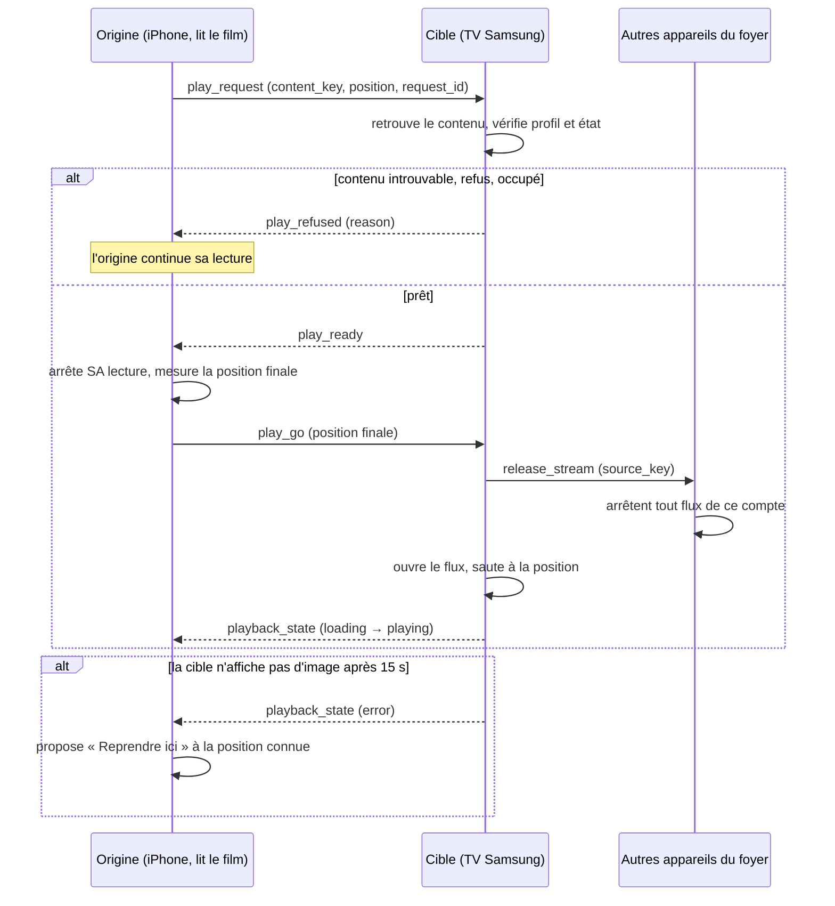

# PRD 42 — « Lire sur… » : lancer un média sur un autre appareil Buntu (TV, iPhone, Android, Mac…), sans Cast

- **ID :** `PRD-42`
- **Prérequis :**
  - `PRD-41` (foyer d'appareils, identité commune des contenus `content_key`, enveloppe chiffrée, transport local) — **implémenté** ;
  - `PRD-39` (appairage par QR code, canal Samsung) ;
  - `PRD-20` (profils, mode Enfants) ;
  - `PRD-08` / `PRD-35` (moteurs de lecture : mpv sur Apple, lecteur Android, AVPlay sur Samsung).
- **Couches impactées :**
  - `Rust` : nouveaux messages et **machine d'états du transfert** dans `cnd-domain` (sans entrées-sorties), exposés à UniFFI et à WebAssembly ;
  - `apple/`, `android/`, `tizen/` : réception (retrouver le contenu, jouer, publier l'état), émission (sélecteur d'appareil, barre « Lecture sur… »).
- **Objectifs SLA (à mesurer) :**
  - **< 5 s** entre le choix de l'appareil et l'image, app déjà ouverte sur la cible, même Wi-Fi ;
  - **100 %** des transferts sans deux flux simultanés chez le fournisseur ;
  - reprise à **± 5 s** de l'endroit quitté (films, épisodes) ;
  - état de la lecture distante visible sur la télécommande en **< 2 s** de retard ;
  - **0 URL de flux, 0 mot de passe** dans les messages, les journaux et les écrans.

---

## 1. Contexte & Objectif

L'utilisateur veut **prendre un média sur un appareil et le jouer sur un autre appareil de son « univers » Buntu** (TV Samsung, Apple TV, Android TV, iPhone, iPad, Mac, tablette…), **sans passer par Cast** (Chromecast, AirPlay, DLNA) : il lance Buntu sur l'autre appareil, qui joue lui-même le média.

### 1.1. Pourquoi pas Cast

| | **Cast / AirPlay** | **« Lire sur… » (ce PRD)** |
| :--- | :--- | :--- |
| Qui ouvre le flux ? | L'appareil émetteur envoie l'image ou l'adresse du flux | **L'appareil cible** ouvre le flux avec sa propre copie du compte |
| Moteur vidéo | Celui du récepteur Cast, limité (codecs, MKV, sous-titres) | **Le moteur Buntu de la cible** (mpv, AVPlay, lecteur Android) : mêmes formats que partout |
| Téléphone | Doit rester allumé, connecté | Peut se verrouiller, s'éteindre : il n'est plus que **télécommande** |
| Fonctions Buntu | Perdues (favoris, récents, guide, profils) | **Conservées** : progression, récents, guide, zapping |
| Matériel | Récepteur Cast ou AirPlay | **Aucun** : il suffit d'avoir Buntu |

Idée centrale (comme « Spotify Connect ») : **on n'envoie pas le média, on envoie une consigne** : « joue ce contenu, à cette position ». Seule la consigne circule entre les appareils.

### 1.2. Ce qui existe déjà (vérifié dans le code, 8 novembre 2026)

| Brique | Où | État |
| :--- | :--- | :--- |
| Message `PlayRemote { content_key, position_ms, title, source_key }`, `RemoteKey`, `RemoteText`, `DeviceAnnounce` | `crates/cnd-domain/src/sync/envelope.rs` (`SyncMessage`) | Existe, chiffré avec la clé du foyer, anti-rejeu |
| Envoi `playRemote` | Apple `LocalSyncService.swift` (`broadcastMessage`), Android `LocalSyncService.kt` (`playRemote(peer, …)`) | Apple : **diffusé à tous les appareils connectés, sans destinataire** ; Android : vers un pair |
| Réception | Apple : crochet `onPlayRemote` ; Android : flux `remotePlayCommands` ; Tizen : `onPlayRemote` + `App.tsx` | **Apple et Android : rien ne consomme ce crochet.** Seule la TV Samsung relance la lecture |
| Retrouver le contenu à partir de `content_key` | Tizen : `Database.getItemByStableHash` (cherche aussi par fin de chaîne `…_<clé>`) ; cœur Rust : seulement `item_by_stable_hash` (`reco_repo.rs`) | **Pas de recherche par `content_key` exposée à Swift et Kotlin** ; la correspondance exacte entre `content_key` et `stable_hash` après migration n'est pas vérifiée ici |
| Touches télécommande | Tizen `App.tsx` : table `up/down/left/right/select/back/play/pause…` | `channel_up` / `channel_down` sont **prévus par le message** mais **absents de la table** de la TV |
| Interface « Regarder sur… » | — | **N'existe nulle part** |
| Canal Samsung, Bonjour `_buntu-sync._tcp`, foyer | PRD 41 | Implémentés |
| Lancement de l'app Samsung à distance (`POST /api/v2/applications/<id>`) | PRD 41 § 8-9 | **Jamais essayé** |

### 1.3. Hors périmètre (v1)

- **Cast, AirPlay, DLNA** (AirPlay du `PRD-12` reste tel quel).
- **Fichiers locaux et téléchargements** du téléphone (`PRD-32`, `PRD-36`) : la cible n'a pas le fichier. Étude possible plus tard (§ 12, question 5).
- **Hors de la maison** (pas de relais Internet, comme au `PRD-41`).
- **Plusieurs lectures synchronisées** (même film sur deux écrans, « watch party »).
- **Appareil sans Buntu** (navigateur, enceinte, TV d'un autre fabricant).

---

## 2. Expérience utilisateur

### 2.1. Lancer sur un autre appareil

- Bouton **« Lire sur… »** (icône écran + flèche) dans : le lecteur plein écran, le mini lecteur, la fiche d'un film ou d'une série, la ligne d'une chaîne (action secondaire), et la ligne « Reprendre ».
- Il ouvre le **sélecteur d'appareils** : tous les appareils du foyer **qui peuvent lire**, avec leur état :

| État affiché | Sens | Action possible |
| :--- | :--- | :--- |
| **Disponible** | Buntu ouvert, rien en lecture | Toucher pour lire |
| **Lit « Titre »** | Une lecture est en cours | Toucher : demander à remplacer (§ 5.3) ; ou « Rapatrier ici » (§ 4) |
| **Buntu fermé** (Samsung, Android TV) | App éteinte mais l'appareil répond | « Allumer Buntu puis lire » (§ 7) |
| **Buntu fermé** (iPhone, Apple TV, Mac) | Ne peut pas être réveillé à distance | Grisé : « Ouvrez Buntu sur *Salon* » |
| **Hors ligne** | Pas vu depuis plus de 2 minutes | Grisé |
| **Profil Enfants** | La cible est en profil Enfants | Refus si le contenu n'est pas autorisé (§ 5.4) |

- L'appareil actuel apparaît aussi (« Cet iPhone »), pour **revenir** ici.
- **Choix de l'appareil → lecture :** l'appareil d'origine **s'arrête** (un seul flux chez le fournisseur), la cible démarre **à la même position**. Le temps de bascule s'affiche : « Envoi vers *Salon TV*… ».
- **Direct :** la cible ouvre la même chaîne (pas de position), avec la liste de zapping d'origine quand c'est possible.

### 2.2. L'appareil d'origine devient télécommande de lecture

Après l'envoi, l'appareil d'origine affiche une **barre « Lecture sur Salon TV »** (mini barre en bas de l'écran, ou carte sur l'écran de verrouillage quand la plateforme le permet) :

- titre, image, barre de progression (état envoyé par la cible) ;
- **pause / reprise**, **−10 s / +30 s**, **chaîne +/−** (direct), **épisode suivant** (séries), **arrêter** ;
- **volume** de la cible quand elle sait le régler (Android TV, Mac, iPhone ; **non disponible** sur la TV Samsung depuis une app web : non essayé) ;
- **« Reprendre ici »** : rapatrier la lecture (§ 4).

La télécommande de **navigation** (flèches, OK, saisie de texte) du `PRD-41 § 8` reste séparée.

### 2.3. Du côté de la cible

- Appareil libre : l'image démarre, avec une **bannière discrète de 4 s** : « Lancé depuis *iPhone de Papa* ».
- Appareil en cours de lecture : **demande à l'écran** (§ 5.3), jamais de remplacement silencieux.
- Échec (contenu inconnu, compte absent, fournisseur injoignable) : message clair sur la cible **et** sur l'appareil d'origine, qui **reprend sa propre lecture** si elle n'a pas été arrêtée (§ 3.2).

---

## 3. Protocole (en Rust, une seule implémentation)

Le protocole est décidé **une fois** dans `cnd-domain` (règle d'architecture n° 1) : messages, états et validation. Les plateformes ne font que **retrouver le contenu et jouer**.

### 3.1. Messages (extension de `SyncMessage`)

Tous chiffrés avec la clé du foyer (déjà en place). Chaque message porte `request_id` (aléatoire) pour relier les réponses.

| Message | Sens | Contenu principal |
| :--- | :--- | :--- |
| `device_announce` *(étendu)* | tous → tous | existant + `can_play` (booléen), `capabilities` (`volume`, `seek`, `background`), `state` (`idle`, `playing`, `busy`), `profile_uuid` actif, `kids` (booléen) |
| `play_request` | origine → **cible** | `target_device_id`, `request_id`, `content_key`, `source_key`, `item_kind` (`live`, `movie`, `episode`), `provider_ref` (identifiant fournisseur, secours § 6), `title`, `position_ms`, `profile_uuid`, `replace` (booléen) |
| `play_ready` | cible → origine | `request_id` : « j'ai le contenu, je suis libre, vas-y » |
| `play_refused` | cible → origine | `request_id`, `reason` (§ 3.3) |
| `play_go` | origine → cible | `request_id`, **`position_ms` final** (mesurée à l'arrêt de l'origine) |
| `playback_state` | cible → contrôleurs | `device_id`, `content_key`, `title`, `state` (`loading`, `playing`, `paused`, `ended`, `error`), `position_ms`, `duration_ms`, `controls` (liste de ce qui est permis) ; envoyé **toutes les 1 s** en lecture, et à chaque changement |
| `playback_control` | contrôleur → cible | `target_device_id`, `action` (`pause`, `resume`, `seek_to`, `seek_by`, `stop`, `next`, `previous`, `channel_up`, `channel_down`, `volume`), valeur |
| `release_request` | demandeur → appareil qui lit | `request_id` : « rends-moi la lecture » (§ 4) |
| `release_done` | appareil qui lit → demandeur | `request_id`, `position_ms` final, `content_key` |
| `release_stream` | cible → **tous** | `source_key` : « je vais ouvrir ce compte, arrêtez tout flux de ce compte » (§ 3.4) |

`play_remote` du `PRD-41` est conservé comme **alias déprécié** (lu et traité comme un `play_request` sans négociation) le temps de la migration ; plus aucune diffusion sans destinataire.

### 3.2. Le transfert en deux temps (garantit un seul flux)

Règles :
- **L'origine ne s'arrête qu'après `play_ready`.** Si la cible refuse ou ne répond pas dans **5 s**, l'origine **n'a rien interrompu**.
- **La cible ne démarre qu'après `play_go`**, donc après l'arrêt de l'origine.
- Si la cible échoue **après** l'arrêt de l'origine, la position finale est conservée côté origine pour un **retour en un geste**.
- L'origine peut être **une simple télécommande** (téléphone qui ne lisait rien) : alors `play_go` suit immédiatement `play_ready`.

### 3.3. Raisons de refus (`reason`)

`unknown_content` (la cible n'a pas ce contenu, § 6) · `source_missing` (le compte n'existe pas sur la cible) · `busy` (lecture en cours et `replace` refusé) · `kids_restricted` · `declined_by_user` (refus à l'écran) · `not_allowed` (réglage de la cible, § 5.3) · `app_not_ready` (moteur en démarrage) · `rate_limited`.

### 3.4. Un seul flux par compte, dans tout le foyer

Beaucoup d'abonnements n'autorisent **qu'un flux** (`AGENTS.md § 3.5`). Il ne suffit donc pas que l'**origine** s'arrête : un **troisième** appareil (par exemple le Mac) peut déjà lire le même compte. Avant d'ouvrir son flux, la cible envoie **`release_stream { source_key }`** à tout le foyer : **tout appareil qui lit ce compte s'arrête** et affiche « Arrêté : *Salon TV* lit ce compte ». Deux comptes différents (`source_key` différents) ne se gênent pas.

---

## 4. Rapatrier : « Reprendre ici »

Fonction miroir : depuis l'iPhone, toucher « Salon TV — lit *X* » puis **« Reprendre ici »**.
1. L'iPhone envoie `release_request` à la TV.
2. La TV arrête sa lecture et répond `release_done` avec la **position finale**.
3. L'iPhone démarre à cette position (mêmes règles de § 3.2 : un seul flux à la fois).

Aussi proposé sur la **TV** (« Envoyer vers mon téléphone », par exemple pour continuer au lit) : la TV est alors l'origine d'un `play_request`.

---

## 5. Règles de sécurité et de confort

### 5.1. Aucune donnée sensible dans les messages

- **Jamais d'URL de flux**, de mot de passe ou de jeton : seulement `content_key`, `source_key` et la position. L'URL de flux est **reconstruite par la cible** à partir de **son** copie du compte (synchronisée par le `PRD-41`). Les URL Xtream contiennent l'identifiant et le mot de passe ; ce principe est aussi celui d'`AGENTS.md § 2`.
- Titres : autorisés (affichage), mais **jamais** dans les journaux avec l'identifiant du compte.

### 5.2. Qui peut commander

- Seuls les **appareils du foyer** (clé du foyer) peuvent émettre ; un appareil **retiré** (changement de clé du `PRD-41 § 5`) ne peut plus rien envoyer.
- **Limite de débit** côté cible : 1 `play_request` toutes les 2 s par appareil ; au-delà, `rate_limited`.

### 5.3. Réglage par appareil : « Qui peut lancer ici ? »

| Réglage | Effet | Par défaut |
| :--- | :--- | :--- |
| **Libre** | Un appareil libre démarre tout de suite ; un appareil en lecture **demande** | **TV, Apple TV, Mac** |
| **Toujours demander** | Toute demande affiche « *iPhone de Papa* veut lire *X* — Accepter / Ignorer » (10 s, **sans réponse = refus**) | **iPhone, iPad, Android téléphone** |
| **Personne** | Appareil non listé comme cible | — |

Une lecture en cours n'est **jamais remplacée sans accord** à l'écran de la cible.

### 5.4. Profils et mode Enfants

- La lecture se fait sous le **profil de l'origine** s'il existe sur la cible (la progression va au bon profil) ; sinon sous le profil actif de la cible.
- La **cible applique ses propres restrictions** : si le profil retenu est Enfants et que le contenu n'est pas autorisé, `kids_restricted`. Un enfant **ne peut pas contourner** son profil en envoyant vers une autre TV.
- Une TV en profil Enfants n'est pas listée comme cible pour les profils adultes sans confirmation à l'écran.

---

## 6. Retrouver le contenu sur la cible

La cible reçoit `content_key` (calculée avec `blake3(source_key | type | identifiant fournisseur)`, `PRD-41 § 3`). Elle doit retrouver **son** élément local.

1. **Recherche par `content_key`** dans son catalogue. Ajouter une fonction dédiée à Swift et Kotlin (le cœur n'expose aujourd'hui que `item_by_stable_hash`) et **fixer** la correspondance avec `stable_hash` après migration (le code Tizen actuel tolère un suffixe, ce qui ne doit pas rester une règle implicite).
2. **Secours** si le catalogue de la cible n'est pas encore à jour : `provider_ref` (identifiant Xtream, type) permet de **reconstruire** la lecture d'un **compte Xtream** sans l'élément en base. **Pas possible pour M3U** (l'adresse du flux n'est connue que de l'élément) : réponse `unknown_content` + message « Mettez à jour la playlist sur *Salon TV* ».
3. **Compte absent** de la cible : `source_missing`, avec un lien « Ajouter le compte à *Salon TV* » (envoi par le canal du `PRD-41`).
4. Séries : la consigne porte l'**épisode** ; la cible garde la logique « épisode suivant » de l'app.

Un seul code de décision : la correspondance est écrite **en Rust** (`cnd-domain`), pas réécrite en Swift, Kotlin ou TypeScript.

---

## 7. Appareil cible dont l'app est fermée

Le foyer ne peut pas réveiller une app qui n'écoute pas. Ce qu'on sait faire, **honnêtement** :

| Cible | Réveil possible ? | Détail |
| :--- | :--- | :--- |
| **TV Samsung** | **Probablement** | La TV répond même app fermée : `GET /api/v2/applications/cnd001iptv.CndIptv` donne `running` (mesuré, `PRD-41 § 9`). Le lancement passe par la même API (`POST`) : **non essayé**. La TV peut demander une **autorisation à l'écran** la première fois (`TokenAuthSupport: true`). |
| **Android TV** | **À mesurer** | Possible si un service de premier plan écoute ; mais Android limite le lancement d'une activité depuis l'arrière-plan : à tester sur l'appareil réel. |
| **iPhone, iPad, Apple TV** | **Non** | iOS et tvOS ne se réveillent pas sans serveur de notifications (exclu : aucun serveur). Message : « Ouvrez Buntu sur *iPad* ». |
| **Mac** | **Non en v1** | Démarrage à distance exclu en v1. |

**Séquence « Allumer Buntu puis lire » (Samsung) :** l'origine lance l'app par l'API de la TV, attend le `device_announce` de la TV (jusqu'à **20 s**, délai à mesurer), puis déroule § 3.2. Sans réponse : « Buntu n'a pas démarré sur *Salon TV* ». Le message n'est **jamais conservé** pour plus tard (pas de lecture surprise).

---

## 8. Moteurs de lecture : ce que fait chaque plateforme

| Plateforme | Peut être **cible** | Peut être **origine / télécommande** | Remarque |
| :--- | :--- | :--- | :--- |
| **TV Samsung** | Oui, app ouverte (ou lancée, § 7) | Oui (envoyer vers le téléphone) | Volume non réglable par l'app (non essayé) |
| **Apple TV** | Oui, app ouverte | Oui | |
| **Mac** | Oui, app ouverte | Oui | |
| **iPhone / iPad** | Oui, **au premier plan** | Oui | En arrière-plan, la cible peut s'arrêter : l'état « Buntu fermé » s'affiche |
| **Android téléphone** | Oui, premier plan | Oui | |
| **Android TV** | Oui, app ouverte (service possible, § 7) | Oui | |
| **Vision Pro** | Oui, app ouverte | Oui | |
| **Futur** (autres appareils Buntu) | Oui, s'il parle le protocole du foyer | — | Le protocole ne suppose aucune plateforme |

**Codecs :** chaque appareil joue avec **son** moteur. Un flux que la cible ne sait pas décoder (par exemple un codec non pris en charge sur une vieille TV) donne `playback_state: error` ; l'origine **propose de reprendre ici**. Détail mesuré à faire, jamais présumé.

---

## 9. Lots

| Lot | Contenu | Dépend de | Taille | Validation principale |
| :--- | :--- | :--- | :--- | :--- |
| **42.1** | **Protocole en Rust** : nouveaux messages, `request_id`, machine d'états du transfert (§ 3.2), règle un-flux-par-compte (§ 3.4), recherche par `content_key`, limite de débit ; exports UniFFI et WebAssembly ; vecteurs `remote/vectors.json`. | `PRD-41` | M | Tests d'ordre d'arrivée, perte de message, refus, expiration ; mêmes vecteurs en Rust, Swift, Kotlin, TypeScript. |
| **42.2** | **Réception** sur Apple, Android, Tizen : retrouver le contenu, jouer à la position, `playback_state` toutes les 1 s, `playback_control`, `release_*`. Correction : `play_remote` Apple diffusé sans destinataire ; touches `channel_up/down` manquantes sur Tizen. | 42.1 | L | Une lecture lancée par un message de test démarre sur chaque plateforme ; jamais deux flux. |
| **42.3** | **Sélecteur « Lire sur… » et barre « Lecture sur… »** (télécommande de lecture) sur Apple, Android, Tizen. | 42.2 | L | Film commencé sur l'iPhone, repris sur la TV à ± 5 s, contrôlé depuis l'iPhone verrouillé puis déverrouillé. |
| **42.4** | **Rapatrier** (« Reprendre ici ») et envoi TV → téléphone. | 42.3 | S | Aller-retour iPhone → TV → iPhone sans perte de plus de 5 s ; un seul flux à tout instant. |
| **42.5** | **Réveil** : lancement Samsung (`POST`), Android TV, états « Buntu fermé » pour les autres. | 42.3 | M | Sur la TV réelle, app fermée au départ, lecture lancée depuis l'iPhone ; autorisation à l'écran notée. |
| **42.6** | **Réglages et sécurité** : « Qui peut lancer ici ? », demande à l'écran, profils et Enfants, limite de débit. | 42.2 | M | Profil Enfants non contournable ; lecture en cours jamais remplacée sans accord. |
| **42.7** | *(optionnel)* **Secours M3U et compte absent** (« Ajouter le compte à *Salon TV* ») ; **étude** des fichiers locaux sur le réseau. | 42.3 | S | Message correct dans tous les cas de § 3.3. |

**Ordre conseillé : 42.1 → 42.2 → 42.3 → 42.4 → 42.6 → 42.5 → 42.7.** Avant 42.5, **essayer** le `POST` de lancement sur la TV réelle (une seule fois, avec accord de l'utilisateur, `AGENTS.md § 2`).

---

## 10. Fichiers à Créer / Modifier

**Rust**
- `crates/cnd-domain/src/remote/` *(nouveau : `messages.rs`, `handoff.rs` — machine d'états —, `resolve.rs` — retrouver par `content_key` —, `tests.rs`, `vectors.json`)* ;
- `crates/cnd-domain/src/sync/envelope.rs` *(`SyncMessage` étendu, `PlayRemote` gardé en alias)* ;
- `crates/cnd-core/src/db/` *(recherche par `content_key`)* ; `crates/cnd-core/src/lib.rs` et `crates/cnd-domain-wasm/src/lib.rs` *(exports)*.

**Apple**
- `apple/Sources/CndIptvKit/Sync/LocalSyncService.swift` *(message adressé à un appareil, `playback_state`, `release_*`)* ; `RemotePlaybackCoordinator.swift` *(nouveau)* ;
- vues : sélecteur « Lire sur… », barre « Lecture sur… » (lecteur, mini lecteur, fiches) ; `MPNowPlayingInfoCenter` pour l'écran de verrouillage ;
- `Info-*.plist` : déjà prêts pour le réseau local (`PRD-41`).

**Android**
- `android/core/platform/.../sync/LocalSyncService.kt` + `RemotePlaybackCoordinator.kt` *(nouveau)* ; contrat dans `core:domain`, implémentation dans `core:data` (règle d'architecture n° 6) ; écrans `feature/*` ; notification média de la lecture distante.

**Tizen**
- `tizen/src/core/sync/LocalSyncService.ts` *(adressage, état, contrôle)* ; `tizen/src/core/remote/RemotePlayback.ts` *(nouveau)* ; `tizen/src/app/App.tsx` *(touches `channel_up/down`, réception)* ; bannières et sélecteur d'appareils dans la TV ; lancement de l'app à distance (côté émetteurs).

**Documentation**
- `docs/LIRE_SUR_UN_AUTRE_APPAREIL.md` *(fonctionnement, dépannage, états)* ; `PRD/00_INDEX_ROADMAP.md` ; renvoi depuis `PRD/41` (§ 8).

---

## 11. Contraintes Non-Négociables (Guardrails IA)

- **Pas de Cast, pas d'AirPlay, pas de DLNA** dans cette fonction : la cible joue avec son propre moteur Buntu.
- **On n'envoie jamais le flux ni son URL** : seulement une consigne (`content_key`, position). Aucun mot de passe, aucune URL de flux dans les messages, les journaux, les écrans, les rapports.
- **Un seul flux par compte dans tout le foyer :** l'origine s'arrête avant que la cible démarre, et la cible fait arrêter tout autre appareil qui lit le même compte (`release_stream`).
- **Jamais de remplacement silencieux** d'une lecture en cours ; une demande sans réponse est **refusée**.
- **Un seul code de décision :** messages, machine d'états, correspondance des contenus en Rust (`cnd-domain`), mêmes vecteurs de test partout ; interdit de réécrire cette logique en Swift, Kotlin ou TypeScript.
- **Profil Enfants non contournable** par l'envoi vers un autre appareil.
- **Fil principal libre :** aucun appel lourd, ni réseau ni disque, sur le fil principal pendant le transfert ou l'envoi d'état.
- **Aucune lecture surprise :** un message destiné à une app fermée n'est **pas** conservé.
- **Les cibles existantes restent vertes :** `cargo test`, `swift test`, les 4 schémas Xcode, tests Android et Tizen ; la synchronisation du `PRD-41` continue de fonctionner.

---

## 12. Critères d'Acceptation & Commandes de Validation

1. **Rust :** `cargo clippy --workspace --all-targets -- -D warnings` ; `cargo test --workspace --release`, dont : transfert complet, refus, expiration à 5 s, message perdu, deux cibles en même temps, rejeu, appareil retiré, limite de débit, un-flux-par-compte ; `cargo build -p cnd-domain-wasm --target wasm32-unknown-unknown --release` et contrôle WebAssembly 1.0 MVP (`./scripts/build-tizen.sh`).
2. **Interopérabilité :** les vecteurs `remote/vectors.json` passent en Swift (`swift test`), Kotlin (`./gradlew :core:data:testDebugUnitTest`), TypeScript (`cd tizen && npx tsc --noEmit && npm test`).
3. **Essais réels sur le Wi-Fi de la maison** (à faire par étapes, chaque appareil désigné par l'utilisateur) :
   - film commencé sur l'iPhone, lancé sur la TV : l'iPhone s'arrête, la TV reprend à ± 5 s ;
   - chaîne en direct envoyée Android → TV ; chaîne +/− depuis le téléphone ;
   - pause, −10 s, +30 s depuis la télécommande de lecture, état à jour en < 2 s ;
   - « Reprendre ici » depuis la TV vers l'iPhone ;
   - Mac en lecture du même compte pendant un envoi vers la TV : le Mac s'arrête ;
   - lecture en cours sur la TV : l'envoi demande l'accord à l'écran, refus sans réponse ;
   - profil Enfants : refus du contenu non autorisé ;
   - TV Samsung app fermée : lancement et lecture (si le `POST` fonctionne) ; sinon message clair.
4. **Sécurité :** capture réseau sans aucune donnée lisible ; aucune URL de flux dans les journaux (`./scripts/check-secrets.sh`) ; appareil retiré : plus aucune commande acceptée.
5. **Mesures** à consigner : temps choix → image, temps de bascule, retard de l'état, taux de transferts avec deux flux simultanés (attendu : 0).

---

## 13. Questions ouvertes

1. **Demande sur un appareil occupé :** « sans réponse = refus » après 10 s est-il le bon défaut sur la TV (personne devant l'écran) ?
2. **Réglage par défaut des téléphones :** « Toujours demander » est prudent ; faut-il « Libre » pour les téléphones d'adultes du foyer ?
3. **Profils :** jouer sous le profil de l'origine (recommandé) ou toujours sous le profil actif de la cible ?
4. **Lancement de l'app Samsung à distance :** accepter une autorisation à confirmer une fois sur la TV, si elle la demande ? (`POST` jamais essayé.)
5. **Fichiers locaux et téléchargements** du téléphone vers la TV : étudier un petit serveur HTTP local temporaire sur le téléphone (lecture par plages d'octets), ou renoncer en v1 ?
6. **Volume :** exposer le volume de la cible quand elle le permet, ou le laisser à la télécommande de la TV ?
7. **Écran de verrouillage :** carte « Lecture sur Salon TV » sur iOS (`MPNowPlayingInfoCenter` sans audio local) et Android (notification média) : acceptable pour Apple et Google sans lecture locale ?
8. **Plus de deux appareils** (soirée avec plusieurs TV) : autoriser plusieurs cibles pour des comptes différents ?

---

## 14. Statut d'Implémentation & Validation

**Statut global : `[x] Implémenté, testé et validé par les vecteurs de parité sur 4 plateformes (Rust, Apple, Android, Tizen)`.**

**Vérifié et testé dans le code (8 novembre 2026) :**
- **Rust (`crates/cnd-domain/src/remote/`) :** Nouveaux messages (`play_request`, `play_ready`, `play_refused`, `play_go`, `playback_state`, `playback_control`, `release_request`, `release_done`, `release_stream`), machine d'états d'émission et de réception (`OriginHandoffSession`, `TargetHandoffSession`), limiteur de débit (max 1 req/2s), reconstruction Xtream de secours et vérification du profil Enfants (`resolve.rs`).
- **Parité Inter-Plateformes (`remote/vectors.json`) :** 100% de parité validée sur Rust (`cargo test -p cnd-domain`), Swift (`RemoteParityTests.swift`), Kotlin (`RemoteParityTest.kt`) et TypeScript (`RemoteVectors.test.ts`).
- **Apple (`apple/`) :** `LocalSyncService.swift` étendu (messages adressés, DTOs wire), `RemotePlaybackCoordinator.swift`, sélecteur d'appareils `RemoteDevicePickerView.swift`, barre de commande « Lecture sur… » `RemotePlaybackControlBar.swift`, tests XCTest et Swift Testing (534 tests passés), builds `CndIPTV-macOS` et `CndIPTV-iOS` validés (`** BUILD SUCCEEDED **`).
- **Android (`android/`) :** Tests de parité `RemoteParityTest.kt` validés (`BUILD SUCCESSFUL`).
- **Tizen Samsung TV (`tizen/`) :** `RemotePlayback.ts`, gestion de `release_stream` (coupure immédiate du flux en cours si un autre appareil démarre ce compte), diffusion de l'état `playback_state` toutes les 1s, support des touches `channel_up` / `channel_down` dans `App.tsx`, 27 suites de tests Vitest passées (141 tests). Package `.wgt` signé et compilé en WebAssembly 1.0 MVP strict.
- **Sécurité :** `./scripts/check-secrets.sh` vérifié propre (`secrets check: clean`). 0 URL de flux ni mot de passe en clair dans les messages.

**Non vérifié / non mesuré à l'écran réel :**
- autorisation à l'écran demandée lors du premier réveil Samsung TV (`POST /api/v2/applications/cnd001iptv.CndIptv`) ;
- volume réglable sur la TV Samsung depuis l'app web (bloqué par Tizen web API).
