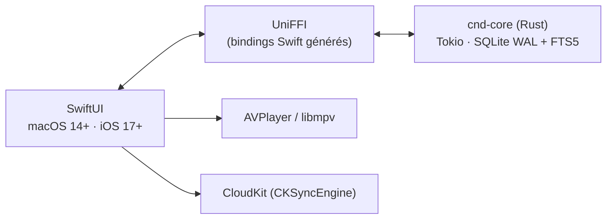

<p align="center">
  
</p>

<h1 align="center">CND IPTV</h1>

<p align="center">
  Lecteur IPTV et gestionnaire de téléchargements 100 % natif pour <b>macOS</b>, <b>iPhone</b> et <b>iPad</b>.<br>
  Interface SwiftUI, moteur Rust (SQLite + FTS5), lecture <code>AVPlayer</code> + <code>libmpv</code>.
</p>

---

## Fonctionnalités

| | |
|---|---|
| **Sources** | Playlists M3U / M3U8 (URL ou fichier déposé sur la fenêtre), comptes Xtream Codes avec test du compte. Création, modification, suppression, synchronisation unitaire ou globale. Mots de passe dans le Trousseau. |
| **Partage de sources** | « Partager… » sur une source (clic droit) ou « Partager des sources… » : fichier `.cndshare`, lien `cndiptv://` ou QR code, **chiffrés** (AES-GCM, code aléatoire de 26 caractères) et valables 1 h, 24 h ou 7 jours. Sans identifiants par défaut ; le mot de passe n'est inclus que sur demande. Import avec aperçu, gestion des doublons et mot de passe écrit dans le Trousseau (menu Fichier > « Importer un partage… », double-clic sur un `.cndshare`, ou dépôt sur la fenêtre). |
| **Live TV** | Catalogue de dizaines de milliers de chaînes, catégories avec compteurs, sections Récents / Favoris, grille ou liste, programme en cours et jauge de progression, zapping suivant / précédent. |
| **Guide TV (EPG)** | Grille horaire XMLTV, fiche d'un programme, programme complet d'une chaîne. |
| **Assistant IA** | Palette `⌘K` : « France 2 », « chaîne 6 », « suivante », « mets le match du PSG », « une chaîne d'info en anglais »… Résolution **locale d'abord** (sans réseau), puis votre propre fournisseur (**Gemini**, tout serveur **compatible OpenAI** dont Ollama / LM Studio en local, **Anthropic Claude**) avec votre clé. La réponse est validée : seule une chaîne de votre catalogue peut être lancée. |
| **Films et Séries** | Affiches, reprise de lecture, favoris, séries multi-saisons, lecture d'une saison entière, enrichissement OMDb à la demande. La fiche s'affiche à droite, sous le lecteur. |
| **Recherche** | Plein texte (FTS5) : début de mot, sans accents, **dans toutes les catégories**. |
| **Lecteur** | `AVPlayer` pour HLS / MP4 / MOV, `libmpv` pour MKV / TS / AVI / FLV. Bascule automatique, reconnexion (3 essais), pistes audio et sous-titres, vitesse, plein écran (bouton ou double-clic), image dans l'image, AirPlay, Now Playing, lecteurs externes (IINA, VLC, Infuse, Outplayer). |
| **Téléchargements** | Moteur multi-segments parallèle (`pwrite`), pause / reprise, barre de progression par segment, lots d'URLs, saison entière dans `Série/Season 01/`. |
| **Réglages et journaux** | Segments, taille des parties, User-Agent, clé OMDb, dossier de téléchargement (marque-page sécurisé sur macOS). Console des journaux (réseau, lecteur) ouvrable depuis n'importe quel écran. |
| **iCloud** | Synchronisation des sources, favoris et progression (jamais le catalogue). Désactivée proprement (« Mode local uniquement ») sans configuration iCloud. |

## Démarrage rapide

```bash
brew install go-task        # lanceur de tâches
brew install mpv            # optionnel : lecture MKV / TS / AVI (libmpv)
task doctor                 # vérifie les outils nécessaires
task run                    # compile, assemble build/CndIPTV.app et lance l'app
```

La première compilation du cœur Rust est longue ; les suivantes sont incrémentales.
`task run` quitte l'instance déjà ouverte avant de lancer la nouvelle version.

### Prérequis

- macOS 14 ou plus récent, **Xcode** (Swift 5.9+, cibles macOS 14 / iOS 17)
- **Rust** stable (`rustup`) avec les cibles Apple :

  ```bash
  rustup target add aarch64-apple-darwin x86_64-apple-darwin \
                    aarch64-apple-ios aarch64-apple-ios-sim x86_64-apple-ios
  ```
- [go-task](https://taskfile.dev) (`brew install go-task`)
- `libmpv` (optionnel) : sans elle, seuls les formats lus par `AVPlayer` fonctionnent.

## Tâches (`task`)

`task` seul liste toutes les tâches. Les principales :

| Tâche | Effet |
|---|---|
| `task run` (`dev`, `start`) | Build debug, bundle `.app` signé en local, lancement |
| `task run:release` | Idem en release |
| `task run:fresh` | Reconstruit d'abord le XCFramework Rust |
| `task run:logs` | Lance dans le terminal pour voir la sortie standard |
| `task bundle` | Assemble `build/CndIPTV.app` sans lancer |
| `task test` | Tests Rust, pont FFI et application |
| `task lint` | Clippy (`-D warnings`) |
| `task xcframework` | Régénère l'XCFramework et les bindings Swift (**après toute modification de l'API `cnd-core`**) |
| `task xcode:macos` / `task xcode:ios` | `xcodebuild` (`CONFIG=Release` pour la release) |
| `task check` | Validation complète : clippy, tests release, XCFramework, tests Swift, builds Release macOS et iOS |
| `task icon` | Régénère `assets/AppIcon.icns` depuis le logo SwiftUI |
| `task cli -- download <url>` | CLI Rust de diagnostic |
| `task clean` / `task clean:core` | Supprime `build/` / `target/` (avec confirmation) |

> Le test de performance d'ingestion (50 000 éléments en moins de 1,5 s) peut échouer par intermittence
> quand la machine est très chargée ; il passe seul ou machine calme.

## Architecture



- **Cœur Rust** (`crates/cnd-core`) : base SQLite (WAL, index couvrants, FTS5), ingestion M3U en flux, client Xtream, moteur XMLTV, requêtes catalogue / favoris / historique, enrichissement OMDb, moteur de téléchargement multi-segments, télémétrie, synchronisation (delta Last-Write-Wins).
- **Pont** (`apple/Packages/CndCoreBridge`) : Swift Package local contenant l'`XCFramework` universel (macOS arm64 + x86_64, iOS Simulator, iOS appareil) et les bindings UniFFI.
- **Application** (`apple/Sources/CndIptvApp`) : SwiftUI. Sur macOS, une `NavigationSplitView` avec un panneau latéral (lecteur + détails) ; sur iOS, une `TabView` avec mini-lecteur persistant.

### Structure du dépôt

```text
cnd-iptv-native/
├── Taskfile.yml                      # toutes les tâches du projet
├── Cargo.toml                        # workspace Rust
├── crates/
│   ├── cnd-core/src/                 # db/ iptv/ downloader/ metadata/ telemetry/ + exports UniFFI
│   └── cnd-cli/                      # outil CLI de diagnostic
├── apple/
│   ├── Package.swift
│   ├── Packages/CndCoreBridge/       # XCFramework + bindings Swift
│   ├── Sources/CndIptvApp/
│   │   ├── App/                      # navigation adaptative, commandes de menu
│   │   ├── Features/                 # Sources, LiveTV, EPG, Movies, Series, VOD, Downloads, Settings, Console
│   │   ├── Player/                   # AVPlayer, libmpv, PiP, AirPlay, Now Playing, gestes
│   │   ├── Shared/                   # cache d'images, recherche, logo, journal applicatif…
│   │   ├── Security/                 # Trousseau, dossier de téléchargement
│   │   └── Sync/                     # synchronisation iCloud
│   └── Tests/CndIptvAppTests/
├── assets/                           # icône de l'application
├── scripts/                          # build-xcframework.sh, run-macos.sh
├── PRD/                              # spécifications et état d'avancement (voir 00_INDEX_ROADMAP.md)
└── reprise.md                        # notes techniques et pièges connus
```

## Raccourcis

**Menus macOS** : `⌘N` ajouter une source · `⌘O` importer un M3U · `⌘R` actualiser les sources · `⇧⌘C` journaux · `⌘↑` / `⌘↓` chaîne ou épisode précédent / suivant · `⌥⌘P` image dans l'image · `⌘K` assistant de chaînes.

**Dans le lecteur** (macOS, lecteur actif) : `Espace` lecture / pause · `M` muet · `F` plein écran · `←` / `→` ±10 s · `↑` / `↓` volume · double-clic : plein écran.

**iOS** : double-tap gauche / droite ±10 s · glissement vertical à gauche (luminosité) ou à droite (volume).

## Où sont les données ?

| Donnée | Emplacement |
|---|---|
| Base SQLite | `~/Library/Application Support/CndIptvNative/cnd_iptv.db` |
| Playlists importées | `~/Library/Application Support/CndIptvNative/Imports/` |
| Téléchargements | `~/Downloads/CndIPTV` (modifiable dans Réglages) · `Documents/Downloads` sur iOS |
| Mots de passe Xtream, clés OMDb et IA | Trousseau (`com.cnd.iptv.credentials`) — jamais dans la base |
| Cache des images | `~/Library/Caches/CndThumbnails/` |

## Tests et qualité

```bash
task test      # rapide : Rust + pont + application
task check     # validation complète de livraison
```

Les tests Swift tournent contre un vrai moteur Rust en mémoire (`CndEngine.inMemory()`), sans réseau. Les téléchargements sont testés contre un serveur HTTP local avec `Range`.

## Limites connues

- **iCloud** : le transport CloudKit compile mais n'a pas été essayé sur un vrai compte. L'activer demande un projet Xcode signé avec l'entitlement CloudKit et la clé `CndCloudKitContainerIdentifier` dans l'`Info.plist`. Les mots de passe Xtream ne se synchronisent pas (Trousseau local).
- **Assistant IA** : les formats de requête des trois fournisseurs sont vérifiés par des tests contre de faux serveurs, mais l'app n'a jamais été essayée avec une vraie clé (`GEMINI_API_KEY=… cargo test -p cnd-core --release ai_live_smoke -- --ignored --nocapture` le fait à la demande). Les noms de modèle par défaut sont modifiables dans Réglages.
- **iOS** : le projet est un Swift Package : pas d'icône d'app, d'`Info.plist` ni de `libmpv` embarqué tant qu'il n'y a pas de projet Xcode. Sans `libmpv`, le lecteur reste sur `AVPlayer`. Le dossier `Documents/Downloads` n'apparaît dans l'app Fichiers qu'avec `UIFileSharingEnabled`.
- **mpv** : le décodage matériel passe par `videotoolbox-copy` (une copie par image) ; AirPlay vidéo ne fonctionne qu'avec `AVPlayer`.
- Les gestes iOS, l'image dans l'image et l'AirPlay sont compilés mais n'ont pas été éprouvés sur appareil.

## Feuille de route

Les PRD 01 à 13 du dossier [`PRD/`](PRD/00_INDEX_ROADMAP.md) sont implémentés et cochés (cœur Rust, ingestion, Xtream, EPG, catalogue, OMDb, téléchargements, lecteur, interfaces, écosystème Apple). Le PRD 13 (assistant IA pour changer de chaîne en langage naturel, avec une clé Gemini ou d'un autre fournisseur) est implémenté. Les notes techniques détaillées et les pièges à éviter sont dans [`reprise.md`](reprise.md).

## Licence

`MIT OR Apache-2.0` (voir `Cargo.toml`).
