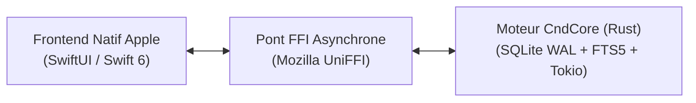

# CND IPTV & FastDown — Native (macOS & iOS)

> Application IPTV & Gestionnaire de Téléchargement 100 % native haute performance ("Zero-Lag").  
> Conforme aux spécifications du document [`prd_migration.md`](../prd_migration.md).

---

## Architecture Hybride Apple + Rust



- **Frontend (UI) :** SwiftUI multiplateforme (macOS 14+ avec `NavigationSplitView`, iOS 17+ avec `TabView`).
- **Core Engine (Backend) :** Rust 2021 multi-threadé (`cnd-core`) piloté par Tokio.
- **Pont FFI :** Mozilla UniFFI générant automatiquement les bindings Swift et headers C.
- **Base de données :** SQLite 3 embarqué (`rusqlite` en mode WAL + indexation plein-texte FTS5).
- **Packaging :** Universal XCFramework (`cnd_coreFFI.xcframework`) supportant :
  - **macOS :** Apple Silicon (`arm64`) + Intel (`x86_64`)
  - **iOS Simulator :** Apple Silicon (`arm64`) + Intel (`x86_64`)
  - **iOS Device :** Apple Silicon (`arm64`)

---

## Structure du Projet

```text
cnd-iptv-native/
├── Cargo.toml                      # Workspace Rust
├── crates/
│   ├── cnd-core/                   # Moteur Core (SQLite, M3U/Xtream, Downloader, UniFFI)
│   │   ├── src/
│   │   │   ├── lib.rs              # Exports UniFFI (CndEngine)
│   │   │   ├── db/                 # Migrations SQLite WAL, Index couvrants, FTS5
│   │   │   ├── iptv/               # Parsers streaming M3U, Xtream JSON, XMLTV
│   │   │   ├── downloader/         # Moteur multi-segments parallèle (pwrite)
│   │   │   ├── metadata/           # Enrichissement OMDb / TMDB
│   │   │   └── telemetry/          # Télémétrie et logs réseau
│   └── cnd-cli/                    # Outil CLI Rust de diagnostic et bench
├── scripts/
│   └── build-xcframework.sh        # Script de build universel XCFramework + UniFFI bindgen
└── apple/
    ├── Package.swift               # Package racine SwiftUI
    ├── Packages/
    │   └── CndCoreBridge/          # Swift Package local contenant le .xcframework + bindings Swift
    └── Sources/
        └── CndIptvApp/             # Application SwiftUI (AppState, ContentView, CndIptvApp)
```

---

## Commandes Rapides

### 1. Tester le Moteur Rust
```bash
# Lancer les tests unitaires SQLite, FTS5 et Engine
cargo test -p cnd-core

# Lancer l'outil CLI de diagnostic
cargo run -p cnd-cli
```

### 2. Compiler le XCFramework Universel (macOS + iOS)
```bash
./scripts/build-xcframework.sh
```

### 3. Tester le Bridge Swift ↔ Rust
```bash
cd apple/Packages/CndCoreBridge
swift test
```

### 4. Lancer l'Application SwiftUI sur macOS
```bash
cd apple
swift run CndIptvApp
```

Ou ouvrir le projet dans Xcode :
```bash
cd apple
xcodebuild -scheme CndIptvNative -destination 'generic/platform=macOS' build
```

