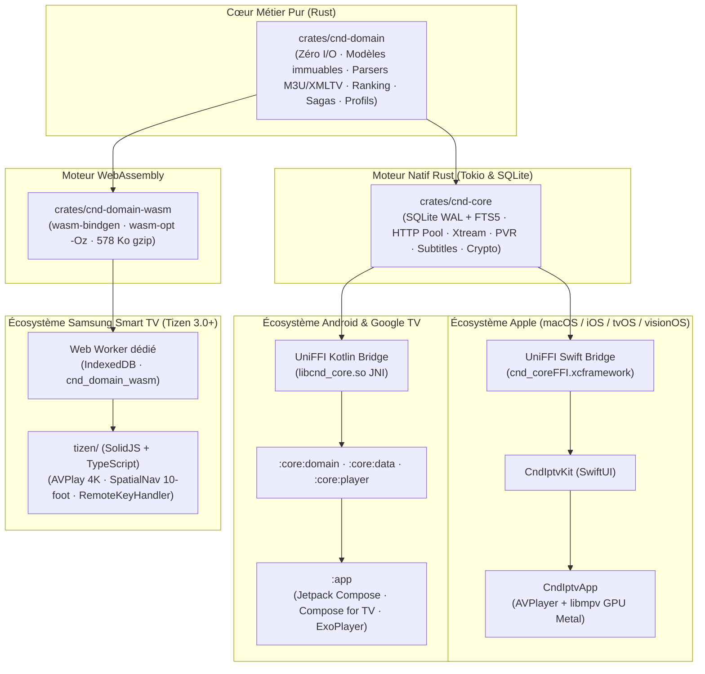

<p align="center">
  
</p>

<h1 align="center">Buntu</h1>

<p align="center">
  <i>Sa bunt ci lépp</i> : la porte d'entrée de tous vos médias.<br>
  Lecteur de flux et gestionnaire de médias universel pour <b>Apple</b> (macOS, iOS, iPadOS, tvOS, visionOS), <b>Android</b> (Téléphones, Tablettes, Android TV, Google TV) et <b>Samsung Smart TV</b> (Tizen 3.0+).<br>
  Moteur métier pur <b>Rust</b>, base locale <b>SQLite WAL + FTS5 / IndexedDB</b>, et moteurs de lecture matériels natifs (<code>AVPlayer</code>, <code>libmpv</code>, <code>ExoPlayer Media3</code>, <code>Samsung AVPlay</code>).<br>
  <i>Buntu est un lecteur neutre : il ne fournit aucun contenu, il lit les flux et fichiers que vous ajoutez en respectant strictement les quotas mono-connexion de vos abonnements.</i>
</p>

<p align="center">
  <a href="#plateformes-prises-en-charge"></a>
  <a href="#architecture-unifiée-monorepo"></a>
  <a href="#tests-et-qualité"></a>
  <a href="LICENSE"></a>
</p>

---

## Sommaire

1. [Plateformes Prises en Charge](#plateformes-prises-en-charge)
2. [Fonctionnalités Principales](#fonctionnalités-principales)
3. [Architecture Unifiée (Monorepo)](#architecture-unifiée-monorepo)
4. [Démarrage Rapide](#démarrage-rapide)
5. [Commandes Rapides (`Taskfile.yml`)](#commandes-rapides-taskfileyml)
6. [Structure du Dépôt](#structure-du-dépôt)
7. [Guides Détaillés par Plateforme](#guides-détaillés-par-plateforme)
8. [Emplacement des Données](#emplacement-des-données)
9. [Tests et Qualité](#tests-et-qualité)
10. [Licence](#licence)

---

## Plateformes Prises en Charge

| Écosystème | Cibles & Versions | Interface UI | Moteur de Lecture | Documentation |
| :--- | :--- | :--- | :--- | :--- |
| **Apple** | **macOS 14+** (Apple Silicon & Intel)<br>**iOS 17+** & **iPadOS 17+**<br>**tvOS 17+** (Apple TV 4K / HD)<br>**visionOS 1.0+** (Apple Vision Pro) | **SwiftUI** natif multi-fenêtres & focus 10-foot | `AVPlayer` (HLS, MP4, MOV) + `libmpv` (MKV, TS, AVI, FLV) avec rendu GPU Metal Zero-Copy | [`docs/BUILD_IPHONE.md`](docs/BUILD_IPHONE.md) |
| **Android** | **Android 7.0+** (`minSdk 24`)<br>Téléphones, Tablettes, Pliables<br>**Android TV & Google TV** (`minSdk 24`) | **Jetpack Compose** (Mobile) & **Compose for TV** (Leanback 10-foot) | **Media3 ExoPlayer** avec relais local mono-connexion (`127.0.0.1`), détection de débit & frame-rate matching | [`docs/BUILD_ANDROID.md`](docs/BUILD_ANDROID.md) |
| **Samsung TV** | **Tizen 3.0 à 8.0+**<br>(Téléviseurs Samsung 2017 à 2025+) | **SolidJS + TypeScript** (sans Virtual DOM) avec polyfills Chromium 56+ | **Samsung AVPlay (`webapis.avplay`)** matériel 4K HDR10/HLG, gestion de la veille TV (`suspend`/`restore`) | [`docs/BUILD_TIZEN.md`](docs/BUILD_TIZEN.md) |

---

## Fonctionnalités Principales

| Domaine | Description |
| :--- | :--- |
| **Gestion des Sources** | Ingestion en flux continu (zéro dépassement mémoire) de playlists M3U / M3U8 volumineuses (50 000+ items en < 1.5 s). Prise en charge native de l'API REST Xtream Codes avec synchronisation paresseuse des épisodes. |
| **Partage Sécurisé** | Export de bouquets ou de sources entières sous forme de fichiers `.cndshare`, liens profonds `cndiptv://` ou QR codes, chiffrés de bout en bout en **AES-GCM 256**. Mots de passe masqués par défaut (opt-in explicite). |
| **Live TV & Zapping** | Grille et liste avec jauges de progression des programmes, zapping instantané (touches Ch+/Ch-, télécommande ou pavé numérique), détection des flux en panne avec bascule transparente vers les serveurs miroirs. |
| **Guide des Programmes (EPG)** | Analyse XMLTV en streaming, grille chronologique interactive, fiches détaillées et programmation directe des enregistrements. |
| **Replay (Catchup)** | Rattrapage direct sur 7 jours des émissions passées via EPG sur les serveurs Xtream Codes et M3U compatibles. |
| **Multi-View** | Affichage simultané de **2 à 4 flux en direct** côte à côte sur écran de salon (tvOS, Android TV, Tizen et macOS). |
| **VOD : Films & Séries** | Regroupement automatique des saisons et épisodes, reprise de lecture avec sauvegarde de la progression à la seconde près, ordre chronologique des sagas (Marvel MCU, Star Wars, Harry Potter, etc.). |
| **Assistant IA & Recherche** | Recherche plein texte locale FTS5 instantanée, recherche en langage naturel (« Mets le match de ce soir », « Film d'action des années 90 ») analysée localement d'abord, puis enrichie via votre propre clé d'API (**Gemini**, **OpenAI / Ollama / LM Studio**, **Anthropic Claude**). |
| **Dialogue Boost & Sous-titres** | Égalisation vocale dynamique (amélioration de l'intelligibilité des dialogues), recherche et téléchargement automatique de sous-titres via **OpenSubtitles v1/v2**, et décalage manuel de synchronisation audio/sous-titres. |
| **Moteur PVR (Enregistreur)** | Planification d'enregistrements futurs en tâche de fond, gestion intelligente des conflits de chaînes et prise en charge des volumes de stockage externes (USB / SSD). |
| **Téléchargements Ininterrompus** | Moteur de téléchargement multi-segments parallèle (`Range`) avec reprise sur panne réseau. Continuité garantie **écran éteint ou appareil en veille** (`URLSessionConfiguration.background` sur iOS/macOS, `ForegroundService` sur Android). |
| **Profils & Contrôle Parental** | Multi-profils étanches (chacun ses favoris et son historique), profil Enfant restreint par catégorie, et verrouillage PIN / biométrique (Face ID, Touch ID) des catégories adultes. |
| **Médiathèque Locale** | Section « Mes fichiers » pour indexer et lire vos vidéos, musiques et photos stockées localement ou sur disque réseau (DLNA / Partage de fichiers). |

---

## Architecture Unifiée (Monorepo)

Le projet applique une séparation stricte des responsabilités (SRP) afin de maximiser la réutilisation de code sans sacrifier les performances de chaque plateforme hôte :



---

## Démarrage Rapide

### Prérequis Généraux

- [go-task](https://taskfile.dev) : `brew install go-task`
- **Rust** stable (`rustup`) avec les cibles nécessaires :
  ```bash
  # Cibles Apple
  rustup target add aarch64-apple-darwin x86_64-apple-darwin \
                    aarch64-apple-ios aarch64-apple-ios-sim x86_64-apple-ios
  # Cible WebAssembly (Tizen)
  rustup target add wasm32-unknown-unknown
  # Cibles Android (si développement Android)
  rustup target add aarch64-linux-android armv7-linux-androideabi x86_64-linux-android
  ```
- **Outils d'optimisation Wasm** (pour Tizen) : `brew install wasm-pack binaryen`
- **Clés d'API par défaut** (optionnel pour affiches OMDb et IA) :
  ```bash
  cp .env.example .env
  task keys
  ```

---

## Commandes Rapides (`Taskfile.yml`)

### 1. Environnement & Utilitaires
```bash
task init               # Prépare un clone neuf : outils, .env, XCFramework (non versionné), projet Xcode
task doctor             # Vérifie la présence des compilateurs et outils requis
task keys               # Régénère les clés d'API masquées depuis le .env
task icon               # Régénère assets/AppIcon.icns et assets/AppIcon-1024.png
task lint               # Exécute cargo clippy --workspace -- -D warnings
task test               # Exécute tous les tests unitaires Rust
```

### 2. Apple (macOS, iPhone, iPad, Apple TV)
```bash
task run                # Compile et lance l'app macOS (build/CndIPTV.app)
task run:release        # Idem en profil Release
task run:iphone         # Compile, signe et installe sur l'iPhone branché (DEVICE="Mon iPhone")
task iphone:devices     # Liste les appareils Apple connectés
task xcframework        # Régénère l'XCFramework universel et les bindings Swift UniFFI
task xcode:macos        # Lance xcodebuild pour macOS
task xcode:ios          # Lance xcodebuild pour iOS Simulator
```

### 3. Android (Téléphones, Tablettes & Android TV)
```bash
task run:android        # Compile, installe l'APK et lance Buntu sur l'appareil Android connecté
task run:android:tv     # Démarre l'application directement en mode Salon 10-foot (Leanback)
task run:android:logs   # Affiche les journaux logcat masqués de Buntu en direct
task android:devices    # Liste les appareils et téléviseurs Android connectés via adb
task android:test       # Exécute les tests unitaires JVM et le linter Android
task android:build      # Compile tous les APK Debug et Release
```

### 4. Samsung Smart TV (Tizen 3.0+)
```bash
task tizen:test         # Exécute les tests unitaires Vitest (AVPlay, client HTTP, télécommande)
task tizen:build        # Compile le Wasm et assemble le paquet build/tizen/cnd-iptv-tizen.wgt
task tizen:install TV_IP="192.168.1.50"  # Déploie le paquet sur le téléviseur en mode Développeur
task tizen:debug        # Active l'inspection distante Chrome DevTools (port 9222)
```

---

## Structure du Dépôt

```text
cnd-iptv-native/
├── Taskfile.yml                # Lanceur de tâches automatisées multiplateforme
├── Cargo.toml                  # Espace de travail Rust monorepo
├── crates/
│   ├── cnd-domain/             # Cœur métier pur, zéro I/O (M3U, XMLTV, sagas, recherche, profils)
│   ├── cnd-domain-wasm/        # Bindings WebAssembly légers pour environnements Web/Tizen
│   ├── cnd-core/               # Moteur natif (SQLite WAL, Tokio, client HTTP, PVR, FFI)
│   └── cnd-cli/                # Outil CLI de diagnostic et d'ingestion locale
├── apple/                      # Projet Swift & SwiftUI universel (macOS, iOS, tvOS, visionOS)
│   ├── Package.swift           # Définition des cibles et dépendances Swift
│   ├── Packages/CndCoreBridge/ # XCFramework binaire + bindings Swift UniFFI
│   └── Sources/CndIptvKit/     # Composants d'interface, lecteurs AVPlayer/libmpv, synchronisation
├── android/                    # Application Android & Android TV modulaire en SRP
│   ├── app/                    # Module hôte (MobileShell & TvShell Leanback)
│   ├── core/                   # :engine (FFI), :domain, :data, :player (ExoPlayer), :designsystem
│   └── feature/                # 13 modules d'écrans indépendants (onboarding, live, vod, pvr...)
├── tizen/                      # Application Samsung Smart TV (Tizen 3.0+)
│   ├── config.xml              # Manifeste de l'application Tizen (résolution 1080p, AVPlay)
│   ├── src/core/               # AVPlayerService, HttpClient mono-connexion, RemoteKeyHandler, Database
│   ├── src/worker/             # Web Worker exécutant cnd-domain-wasm et IndexedDB
│   └── src/features/           # 12 écrans TV en SolidJS optimisés sans Virtual DOM
├── scripts/                    # Scripts de compilation (build-xcframework, build-android, build-tizen)
├── docs/                       # Guides détaillés de build, déploiement et design
│   ├── BUILD_IPHONE.md         # Guide complet iOS (signature, provisionnement, appareils physiques)
│   ├── BUILD_ANDROID.md        # Guide complet Android (NDK, téléphones, Google TV, benchmarks)
│   ├── BUILD_TIZEN.md          # Guide complet Samsung TV (Developer Mode, certificats, sdb)
│   └── BRANDING_BUNTU.md       # Charte graphique (palette Buntu, contraste WCAG AA, design 10-foot)
├── assets/                     # Icônes de l'application (PNG 1024x1024 et ICNS)
└── PRD/                        # 38 Spécifications techniques et index de roadmap (00_INDEX_ROADMAP.md)
```

---

## Guides Détaillés par Plateforme

Pour les instructions complètes de configuration d'environnement, d'installation de certificats et de résolution des problèmes, consultez les guides dédiés :

- 🍏 **Apple (iPhone, iPad, Mac, Apple TV)** : [`docs/BUILD_IPHONE.md`](docs/BUILD_IPHONE.md)
- 🤖 **Android (Téléphone, Tablette, Android TV)** : [`docs/BUILD_ANDROID.md`](docs/BUILD_ANDROID.md)
- 📺 **Samsung Smart TV (Tizen 3.0 à 8.0+)** : [`docs/BUILD_TIZEN.md`](docs/BUILD_TIZEN.md)
- 🎨 **Identité Visuelle & Design System** : [`docs/BRANDING_BUNTU.md`](docs/BRANDING_BUNTU.md)

---

## Emplacement des Données

| Plateforme | Base de Données | Dossier de Téléchargement | Stockage des Clés & Secrets |
| :--- | :--- | :--- | :--- |
| **macOS** | `~/Library/Application Support/CndIptvNative/cnd_iptv.db` | `~/Downloads/CndIPTV` (ou signet choisi) | Trousseau macOS (`com.cnd.iptv.credentials`) |
| **iOS / iPadOS** | Conteneur d'App (Documents) | `Documents/Downloads` (accessible via l'app Fichiers) | Trousseau iOS (Keychain Services) |
| **Android** | `data/data/com.pcoundia.buntu/databases/` | `Download/Buntu/` ou stockage scoped | Android Keystore (`AES/GCM/NoPadding`) |
| **Samsung TV** | `IndexedDB` interne (W3C Storage API) | Non applicable (streaming direct) | `tizen.preference` chiffré localement |

---

## Tests et Qualité

La qualité et l'absence de régressions sont garanties par plus de **350 tests automatisés** à travers toutes les couches de la pile :

```bash
# 1. Tests unitaires du cœur métier pur (27 tests, 0.00s)
cargo test -p cnd-domain

# 2. Tests d'intégration du moteur natif (321 tests : SQLite, M3U, EPG, Xtream, PVR, IA)
cargo test -p cnd-core

# 3. Tests de l'application Tizen (lecteur AVPlay, client HTTP mono-connexion, télécommande)
task tizen:test

# 4. Tests Android JVM et linter
task android:test

# 5. Vérification statique globale (zéro avertissement)
task lint
```

---

## Licence

Ce projet est distribué sous double licence **MIT OR Apache-2.0** (voir [`Cargo.toml`](Cargo.toml)).
