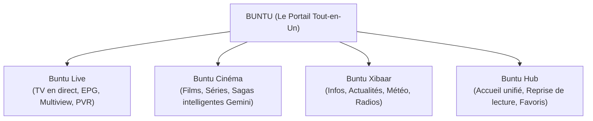

# Buntu — Guide de Marque & Identité (Brand Book)

> **« Sa buntu ci lépp. »**  
> *(Ta porte d'entrée vers tout.)*

---

## 1. Origine & ADN de la Marque

### 1.1 Le Nom : Buntu
* **Racine linguistique :** Wolof (*Bunt*, *Buntu*, *Bountou*).
* **Signification littérale :** **La porte**, le seuil, l'entrée, le portail.
* **Sens figuré :** La passerelle, l'accès privilégié à un univers étendu.
* **Graphie officielle :** **Buntu** (court, épuré, typographique, internationalement mémorisable dans la lignée de *Roku*, *Hulu*, *Ubuntu*).

### 1.2 La Vision : La Super-App All-in-One
Buntu n'est pas un simple lecteur IPTV passif ou un énième clone sans âme.  
C'est **le portail unique (Gateway)** qui réunit au même endroit :
1. **Les flux TV en direct (Live TV)** : Zapping instantané, grille EPG dynamique, Multiview 4 écrans, Timeshift et PVR.
2. **Le Cinéma & les Séries (VOD)** : Catalogue intelligent, affiches 4K, sagas ordonnées par intelligence artificielle.
3. **L'Information & la Vie Quotidienne (Xibaar & Hub)** : Actualités en temps réel, flux radio, météo et alertes locales.
4. **L'Intelligence d'assistance** : Navigation vocale, recommandations prédictives, détection de franchises cinéphiles.

---

## 2. Piliers & Valeurs de Marque

| Valeur en Wolof | Équivalent | Définition & Expression Produit |
| :--- | :--- | :--- |
| **Ubbi** | *Ouverture* | L'application s'ouvre sur tout. Facile, accessible, sans friction d'installation ou de format. |
| **Gaaw** | *Rapidité* | Moteur natif Rust haute performance. Temps de réponse < 50ms, lecture instantanée, zéro saccade. |
| **Léer** | *Clarté & Lumière* | Pureté visuelle de l'interface, haute fidélité 4K HDR, transparence des flux et recommandations limpides. |
| **Téeranga** | *Hospitalité* | Expérience soignée, respect de la vie privée (Local-First), pas de pistage de données, interface chaleureuse. |

---

## 3. Plateforme de Messages & Slogans

### 3.1 Taglines officielles

* 🇸🇳 **En Wolof :**
  * *« Buntu : Sa buntu ci lépp. »* (Ta porte d'entrée vers tout)
  * *« Ubbi buntu, xool lépp. »* (Ouvre la porte, profite de tout)
* 🇫🇷 **En Français :**
  * *« Buntu : La porte d'entrée de tous vos médias. »*
  * *« Votre portail tout-en-un : TV, Cinéma, Infos. »*
  * *« Ouvrez la porte à une nouvelle dimension du divertissement. »*
* 🇬🇧 **En Anglais :**
  * *« Buntu : Your all-in-one media gateway. »*
  * *« One door. Endless entertainment. »*

---

## 4. Identité Visuelle & Design System

### 4.1 Concept de l'Icône d'App (App Icon)
* **Forme centrale :** La lettre majuscule **« B »** sculptée sous la forme d'une **double arche / porte contemporaine entrouverte**.
* **La Fente Lumineuse :** De l'entrebâillement de la porte émane une lueur chaude et moderne (*Léer*), invitant l'utilisateur à entrer dans son univers multimédia.
* **Traitement de surface :** Finition Apple Premium (Liquid Glass, profondeur subtile, fond sombre OLED pour fondre parfaitement sur tvOS, iOS et visionOS).

```
   ┌───────────────┐
   │    ╭────╮     │
   │    │ ▌  ╰╮    │   <-- L'arche supérieure (Portail média / TV)
   │    │ ▌   │    │
   │    │ ▌  ╭╯    │   <-- Faisceau lumineux central
   │    │ ▌  ╰╮    │   <-- L'arche inférieure (Portail infos / VOD)
   │    │ ▌   │    │
   │    ╰─┴───╯    │
   └───────────────┘
```

### 4.2 Palette Chromatique

| Rôle | Nom de la couleur | Code Hex | Description & Usage |
| :--- | :--- | :--- | :--- |
| **Fond Primaire** | *Buntu Midnight* | `#0B0E14` | Noir spatial profond, optimisé pour les écrans OLED Apple et l'ambiance salon cinéma. |
| **Surface & Cartes**| *Buntu Slate* | `#161B26` | Gris bleuté nocturne pour les tuiles de films, EPG et cartes d'actus. |
| **Accent Énergie** | *Teranga Gold* | `#FF9F0A` | Doré chaleureux et prestigieux : boutons d'action, statut Live, favoris. |
| **Accent Tech** | *Léer Cyan* | `#00D2FF` | Bleu vibrant pour les halos de sélection sur Apple TV (focus engine) et badges IA. |
| **Texte Principal** | *Pure White* | `#F5F7FA` | Typographie ultra-lisible à 3 mètres sur grand écran. |
| **Texte Secondaire**| *Muted Silver* | `#8E95A5` | Métadonnées (durée, résolutions, sous-titres, date). |

### 4.3 Typographie
* **iOS / macOS / tvOS / visionOS :** Famille native **SF Pro Display** et **SF Pro Rounded** pour les titres afin d'allier rigueur technologique et rondeur chaleureuse.
* **Logotype :** Lettrage géométrique sur-mesure aux angles arrondis, évoquant des ouvertures et des portes architecturales.

---

## 5. Architecture de l'Offre « All-in-One »

L'application s'articule autour de 4 modules intégrés sans couture :



1. **Buntu Live** : Le meilleur de la télévision linéaire (flux HLS/.ts sans coupure, mosaïque jusqu'à 4 chaînes en direct, Timeshift pour mettre le direct en pause, enregistrement programmé).
2. **Buntu Cinéma** : La vidéothèque VOD complète avec fiches descriptives enrichies, sous-titres synchronisés, classement intelligent des sagas et suggestions personnalisées.
3. **Buntu Xibaar (Infos)** : Le flux d'actualités en direct pour être au courant de tout sans quitter l'application (bandeau d'informations, revues de presse, chaînes d'information en continu, météo).
4. **Buntu Hub** : L'écran d'accueil intelligent qui synthétise ce que vous aimez, vos reprises de lecture immédiates et les temps forts du jour.

---

## 6. Présence Multi-Plateforme (Apple Native)

Buntu est conçu dès le premier jour pour offrir une expérience sur mesure sur chaque écran du quotidien :

* 📺 **Buntu pour Apple TV (tvOS) :** L'expérience reine du salon. Confort visuel à 3 mètres, navigation fluide à la télécommande Siri Remote, affichage 4K HDR avec adaptation automatique de la fréquence d'images (AFR).
* 📱 **Buntu pour iPhone (iOS) :** Le portail dans la poche. Mode Picture-in-Picture (PiP), Live Activities sur l'écran verrouillé et Dynamic Island pour suivre un match ou une émission.
* 💻 **Buntu pour Mac (macOS) :** Productivité et multimédia. Fenêtre flottante compacte toujours au premier plan, raccourcis clavier pro.
* 🥽 **Buntu pour Apple Vision Pro (visionOS) :** Écran spatial géant flottant dans l'espace, immersion totale dans son cinéma personnel.

---

## 7. Directives de Communication & Ton de Voix

* **Chaleureux & Accueillant (*Teranga*) :** On ne parle pas en jargon technique rébarbatif à l'utilisateur. L'accueil est bienveillant, clair et direct.
* **Technologiquement Fière :** Mettre en avant la rapidité du moteur en Rust, la fluidité native et la puissance de l'IA sans arrogance, mais comme une garantie de confort absolu.
* **Racines Universelles :** Revendiquer fièrement l'héritage wolof du nom tout en s'adressant avec élégance au public du monde entier.

