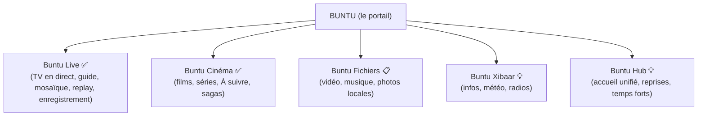

# Buntu — Guide de Marque & Identité (Brand Book)

> **« Buntu : sa bunt ci lépp. »**
> *(Ta porte d'entrée vers tout.)*
>
> ⚠️ Formulation wolof à faire valider par un locuteur natif (voir § 3.2).

*Dernière mise à jour : novembre 2026. Remplace le nom de travail « CND IPTV ».*

---

## 1. Origine & ADN de la Marque

### 1.1 Le Nom : Buntu

- **Racine linguistique :** wolof *bunt* (la porte). *Buntu* est la forme liée, « la porte de… » (*buntu kër* : la porte de la maison). La graphie francisée *Bountou* existe aussi.
- **Signification littérale :** la porte, le seuil, l'entrée.
- **Sens figuré :** la passerelle, l'accès à un univers étendu.
- **Graphie officielle :** **Buntu**.
  - **Forme :** cinq lettres, sans accent, lisible dans toutes les boutiques d'apps.
  - **Mémorisation :** facile à retenir à l'international, dans la lignée de *Roku* ou *Hulu*.
- **Nom complet en boutique :** **Buntu — TV, Films & Séries** (30 caractères au plus pour l'App Store). Variante : **Buntu Player**.

### 1.2 La Vision

Buntu est **le portail unique** qui réunit au même endroit **les sources de l'utilisateur** :
- ses chaînes en direct ;
- ses films et séries ;
- ses propres fichiers.

C'est un **lecteur** : Buntu ne fournit aucun contenu, il lit les sources que l'utilisateur ajoute (playlists M3U, comptes Xtream, fichiers locaux). Ce positionnement est obligatoire dans toute communication (§ 7.3).

### 1.3 Ce qui existe aujourd'hui, et ce qui est la vision

| Promesse de marque | État réel dans l'app | PRD |
| :--- | :--- | :--- |
| TV en direct : zapping, guide TV, mosaïque 4 écrans, pause du direct, enregistrement | ✅ Réalisé | 09, 16, 19, 24 |
| Replay et « revoir depuis le début » | ✅ Réalisé | 15 |
| Films et séries : fiches enrichies, reprise, téléchargement | ✅ Réalisé | 06, 07, 10 |
| Recommandations « À suivre » et chronologie des sagas | ✅ Réalisé (non vérifié avec un vrai fournisseur IA) | 27 |
| Assistant en langage naturel (⌘K) | ✅ Réalisé, avec le fournisseur IA **choisi par l'utilisateur** (Gemini, Claude, compatible OpenAI ou modèle local) | 13 |
| Sous-titres en ligne, Dialogue Boost | ✅ Réalisé | 18 |
| Profils, contrôle parental, mode Enfants | ✅ Réalisé | 20 |
| Partage des sources entre appareils et amis | ✅ Réalisé (sauf partage iCloud vivant) | 26 |
| Taille d'interface réglable, accessibilité | 🟡 En partie | 30, 31 |
| Fenêtre au premier plan, lecteur compact (Mac) | ✅ Réalisé | 29 |
| **Mes fichiers** : vidéo, musique, photos locales | 📋 Prévu | 32 |
| **Buntu Xibaar** : actualités, météo, radios | 💡 Idée, aucun PRD | — |
| **Buntu Hub** : écran d'accueil unifié | 💡 Idée, aucun PRD | — |
| Mode Cinéma spatial sur Vision Pro | 🟡 Fenêtres visionOS seulement, mode Cinéma non réalisé | 22 |

**Règle :** un module « Idée » ou « Prévu » ne figure dans aucun visuel, aucune capture et aucun texte de boutique avant d'être livré.

---

## 2. Piliers & Valeurs de Marque

| Valeur en wolof | Équivalent | Définition & expression produit |
| :--- | :--- | :--- |
| **Ubbi** | *Ouverture* | L'app s'ouvre sur tout : M3U, Xtream, fichiers locaux, formats exotiques (MKV, TS) grâce au double moteur AVPlayer + mpv. |
| **Gaaw** | *Rapidité* | Moteur natif en Rust : recherche locale de chaîne en moins de 50 ms, catalogue de 50 000 éléments parcouru sans attente. Ces chiffres sont mesurés par les tests du projet ; aucune autre promesse chiffrée n'est faite. |
| **Leer** | *Clarté & lumière* | Interface épurée, informations utiles à l'écran (résolution réelle, cadence, HDR), recommandations expliquées (« Suite de la saga · 2/4 »). |
| **Teraanga** | *Hospitalité* | Respect de l'utilisateur. Local-first : aucune donnée de visionnage ne quitte l'appareil, aucun pistage, aucune publicité. La clé IA reste celle de l'utilisateur, avec son consentement. Accessible à tous (VoiceOver, taille du texte, sous-titres). |

**Orthographe :** dans les textes en wolof, on suit l'orthographe officielle (CLAD) : *teraanga*, *leer*. La graphie francisée *Teranga* est réservée aux noms de couleur et aux usages où elle est déjà connue (§ 4.2).

---

## 3. Plateforme de Messages & Slogans

### 3.1 Taglines

- 🇸🇳 **En wolof** (à valider, § 3.2) :
  - *« Buntu : sa bunt ci lépp. »* (Ta porte vers tout.)
  - *« Ubbi bunt bi, xool lépp. »* (Ouvre la porte, regarde tout.)
- 🇫🇷 **En français :**
  - *« Buntu : la porte d'entrée de tous vos médias. »*
  - *« Vos chaînes, vos films, vos fichiers. Une seule porte. »*
  - *« Ouvrez la porte, regardez tout. »*
- 🇬🇧 **En anglais :**
  - *« Buntu: your all-in-one media gateway. »*
  - *« One door. All your media. »*

### 3.2 Validation linguistique (avant tout usage public)

- **Slogans :** les faire relire par au moins deux locuteurs natifs du wolof, l'un de Dakar et l'autre de la diaspora.
- **Point de doute :** *buntu* est la forme liée (« la porte de… »). Seul, avec un possessif, on dit plutôt *sa bunt* (« ta porte »). C'est pourquoi les slogans ci-dessus emploient *sa bunt* et *bunt bi*. Le nom de marque **Buntu** reste valable en tant que nom propre.
- **Prononciation :** l'enregistrer (« BOUN-tou ») pour les vidéos et la page de la boutique.

---

## 4. Identité Visuelle & Design System

### 4.1 Icône d'app

- **Forme centrale :** la lettre **« B »** dessinée comme une **double arche**, une porte contemporaine entrouverte.
- **La fente lumineuse :** de l'entrebâillement émane une lueur chaude (*leer*), qui invite à entrer.
- **Rendu :**
  - fond sombre profond ;
  - icône en couches pour l'effet de profondeur des icônes Apple récentes (tvOS en parallaxe, iOS et macOS en verre) ;
  - variantes claire, sombre et teintée fournies pour iOS.
- **État :** une première version est dessinée en code (`Shared/AppLogoView.swift`, couleurs de `BrandPalette`) : un « B » blanc en deux arches sur fond nuit, avec un filet de lumière dorée dans chaque arche. Elle sert d'icône du Mac (`task icon` produit `assets/AppIcon.icns` et `AppIcon-1024.png`) et de logo de la barre latérale. C'est une base de travail : le dessin final d'un graphiste reste à faire.
- **Contraintes techniques :**
  - **source :** `task icon` régénère l'icône depuis le code ;
  - **lisibilité :** reconnaissable à 16 × 16 px (Dock, Spotlight) ;
  - **tailles à fournir :** l'icône macOS (`.icns`) existe ; **les icônes iPhone, iPad, Apple TV (1280 × 768 en couches) et Vision Pro n'existent pas encore** (le projet n'a pas de catalogue d'images : ces cibles affichent l'icône par défaut du système).

```
   ┌───────────────┐
   │    ╭────╮     │
   │    │ ▌  ╰╮    │   <-- Arche supérieure (TV en direct)
   │    │ ▌   │    │
   │    │ ▌  ╭╯    │   <-- Fente lumineuse centrale
   │    │ ▌  ╰╮    │   <-- Arche inférieure (films, séries, fichiers)
   │    │ ▌   │    │
   │    ╰─┴───╯    │
   └───────────────┘
```

### 4.2 Palette chromatique

| Rôle | Nom de la couleur | Code hex | Usage |
| :--- | :--- | :--- | :--- |
| **Fond primaire** | *Buntu Midnight* | `#0B0E14` | Fond du lecteur et des écrans sombres, optimisé pour les écrans OLED. |
| **Surface & cartes** | *Buntu Slate* | `#161B26` | Cartes de chaînes, affiches, guide TV. |
| **Accent énergie** | *Teranga Gold* | `#FF9F0A` | Boutons d'action, statut « En direct », favoris. |
| **Accent tech** | *Leer Cyan* | `#00D2FF` | Halo de focus sur Apple TV, badges de l'assistant IA. |
| **Texte principal** | *Pure White* | `#F5F7FA` | Texte sur fond sombre, lisible à 3 m. |
| **Texte secondaire** | *Muted Silver* | `#8E95A5` | Métadonnées (durée, résolution, date). |

**Accessibilité de la palette (`PRD-31`), contrastes WCAG calculés (seuil AA : 4,5:1 pour le texte) :**

| Texte | Sur *Midnight* | Sur *Slate* |
| :--- | :---: | :---: |
| *Pure White* | 18,0 | 16,1 |
| *Muted Silver* | 6,4 | 5,7 |
| *Teranga Gold* | 9,4 | 8,4 |
| *Léer Cyan* | 10,7 | 9,6 |

- **Muted Silver est conforme** sur les deux fonds : l'inquiétude de la version précédente de ce document était infondée.
- **Texte sur un bouton doré :** du blanc sur *Teranga Gold* ne donne que **1,9:1** (insuffisant). Le texte d'un bouton d'action doré est en *Buntu Midnight* (**9,4:1**), jamais en blanc.
- **Pas de couleur seule :** *Teranga Gold* et *Léer Cyan* ne servent jamais seuls à signaler un état. Une forme ou un texte les accompagne toujours (par exemple la pastille « EN DIRECT » écrite).
- **Mode clair :** l'app suit le thème du système. Une déclinaison claire de la palette (fond `#F5F7FA`, texte `#0B0E14`, accents inchangés) reste à définir et à tester.
- **Intégration au code :** les valeurs sont dans `Shared/Design/AppBrand.swift` (`BrandPalette`) et les ratios ci-dessus sont vérifiés par des tests (`AppBrandTests`). **L'app n'applique pas encore la palette à ses écrans** : elle utilise toujours la couleur d'accent du système. Seuls l'icône et le logo de la barre latérale l'emploient.

### 4.3 Typographie

- **Apple (iOS, macOS, tvOS, visionOS) :** **SF Pro** pour le texte, avec Dynamic Type et la taille d'interface réglable (`PRD-30`). **SF Pro Rounded** pour les titres et le logotype, pour allier rigueur et chaleur.
- **Logotype :** lettrage géométrique sur mesure aux angles arrondis, avec des ouvertures qui rappellent des portes. Il faut le dessiner en vectoriel et le décliner en version horizontale, en version empilée et en monogramme « B ».

---

## 5. Architecture de l'Offre

L'app s'articule en modules. Ceux qui sont marqués 📋 ou 💡 ne sont pas encore disponibles (§ 1.3).



1. **Buntu Live :** la télévision en direct de vos sources :
   - zapping et guide TV ;
   - mosaïque jusqu'à 4 chaînes ;
   - pause du direct et replay ;
   - enregistrement programmé ;
   - bascule automatique vers un miroir quand un flux tombe.
2. **Buntu Cinéma :** les films et séries de vos sources :
   - fiches enrichies et sous-titres en ligne ;
   - téléchargement en respectant la limite de connexions de l'abonnement ;
   - rangée « À suivre » et carte « Film suivant » dans l'ordre de la saga.
3. **Buntu Fichiers (`PRD-32`) :** vos vidéos, votre musique et vos photos, dans les dossiers que vous autorisez, comme la médiathèque de VLC.
4. **Buntu Xibaar (idée) :** l'actualité sans quitter l'app. À cadrer dans un PRD : sources d'information, droits de diffusion, chaînes d'info existantes dans les sources de l'utilisateur.
5. **Buntu Hub (idée) :** un écran d'accueil qui rassemble reprises, favoris et temps forts. Aujourd'hui, ces éléments sont répartis dans Live TV et Films.

---

## 6. Présence Multi-Plateforme (Apple)

- 📺 **Apple TV (tvOS) :**
  - navigation à la Siri Remote et zapping plein écran ;
  - fréquence d'écran alignée sur la vidéo (AFR, SDR/HDR) ;
  - **à savoir :** l'app tvOS compile et fonctionne au simulateur ; l'essai sur une vraie Apple TV reste à faire.
- 📱 **iPhone et iPad (iOS) :**
  - Picture-in-Picture et AirPlay ;
  - Live Activities et Dynamic Island pour un enregistrement ou une émission ;
  - **à savoir :** ces deux fonctions ne sont pas encore vérifiées sur un appareil.
- 💻 **Mac (macOS) :**
  - fenêtre toujours au premier plan et lecteur compact 16:9 ;
  - mode Cinéma plein écran ;
  - raccourcis clavier (page « Aide > Raccourcis clavier »).
- 🥽 **Vision Pro (visionOS) :** l'interface iPad en fenêtres. L'écran spatial géant (mode Cinéma immersif) est une **vision**, pas une fonction disponible.

---

## 7. Communication & Ton de Voix

### 7.1 Ton

- **Chaleureux et accueillant (*teraanga*) :** pas de jargon. Les messages d'erreur disent quoi faire (« Votre abonnement n'autorise qu'une connexion : le téléchargement démarrera à la fin de la lecture »).
- **Fier de sa technique, sans arrogance :** la rapidité du moteur Rust et la fluidité native sont présentées comme une garantie de confort, jamais comme un argument de comparaison agressif.
- **Racines universelles :** revendiquer l'héritage wolof du nom tout en s'adressant au monde entier. Les textes sont en français d'abord ; l'anglais et le wolof viennent ensuite.

### 7.2 Mots à préférer, mots à éviter

| ✅ Dire | ❌ Ne pas dire |
| :--- | :--- |
| « vos sources », « vos chaînes », « votre abonnement » | « toutes les chaînes du monde », « gratuit », « sans abonnement » |
| « lecteur », « portail » | « IPTV illimitée », « débloquer » |
| « suggestions », « À suivre » | « l'IA sait ce que vous aimez » |
| « vos données restent sur votre appareil » | « 100 % sécurisé », « inviolable » |

### 7.3 Règles légales et de boutique

- **Lecteur seulement :** Buntu ne fournit, n'héberge et ne vend aucun contenu. Les captures de boutique montrent des sources de démonstration libres de droits, jamais de chaînes commerciales ni d'affiches de films protégées.
- **App Store :** le texte de la fiche et les captures respectent les règles d'Apple sur les lecteurs de médias. Aucune promesse d'accès à des chaînes payantes.
- **Données personnelles :** l'étiquette de confidentialité de l'App Store doit refléter le fonctionnement réel :
  - aucune donnée collectée par Buntu ;
  - les fournisseurs IA, OMDb et OpenSubtitles ne sont contactés qu'avec la clé ou l'accord de l'utilisateur (`PRD-13`, `PRD-28`).

---

## 8. Avant le lancement (à faire)

| Vérification | État |
| :--- | :--- |
| Validation des slogans wolof par des locuteurs natifs (§ 3.2) | ⬜ |
| Recherche de marque « Buntu » : OAPI (Afrique francophone), EUIPO, USPTO. **Risque de confusion avec *Ubuntu*** (marque de Canonical, logiciel), à faire évaluer par un juriste | ⬜ |
| Disponibilité du nom dans l'App Store et des domaines (`buntu.app`, `buntu.sn`, `getbuntu.com`) et des réseaux sociaux | ⬜ |
| Dessin définitif de l'icône et du logotype (§ 4.1, § 4.3) ; icônes iPhone, iPad, Apple TV et Vision Pro | 🟡 Première version pour le Mac |
| Contrôle du contraste de la palette (§ 4.2) | ✅ Conforme (déclinaison claire encore à faire) |
| Captures de boutique avec des sources de démonstration libres de droits (§ 7.3) | ⬜ |

## 9. Passage de « CND IPTV » à « Buntu » dans l'app

**Fait (novembre 2026) :**
- **Nom affiché :** `AppBrand.name` (`Shared/Design/AppBrand.swift`) alimente la barre latérale, le titre de la fenêtre, l'écran À propos, les raisons de veille système (« Lecture vidéo Buntu »), le nom d'un partage exporté (« Partage Buntu.cndshare ») et ses messages d'erreur.
- **Fichiers de configuration :** `CFBundleName` et `CFBundleDisplayName` des 4 `Info.plist` et de l'extension d'activités, bundle `.app` assemblé par `scripts/run-macos.sh`, installation dans `/Applications/Buntu.app` par `scripts/install-macos.sh` (le script signale une ancienne copie « CND IPTV.app » sans la supprimer).
- **Identifiants de bundle / packages des apps :** uniformisés sous `com.pcoundia.buntu` (`com.pcoundia.buntu` pour iOS, `.macos`, `.tvos`, `.vision`, `.liveactivity`). Conteneur iCloud `iCloud.com.pcoundia.buntu` et groupe `group.com.pcoundia.buntu`.
- **Textes :** `README.md`, descriptions du `Taskfile.yml`, message d'erreur du moteur Rust pour un fichier de partage invalide, bannière de la CLI.
- **Icône du Mac et logo de la barre latérale** (§ 4.1).
- **Tests :** nom, messages, absence de l'ancien nom dans les textes visibles, contrastes de la palette (`AppBrandTests`).

**Conservé volontairement (identifiants techniques internes) :**
- clés du Trousseau (`com.cnd.iptv.*`), schéma d'URL `cndiptv://` et extension `.cndshare` ;
- dossier de téléchargement `~/Downloads/CndIPTV` : les films déjà téléchargés y sont ;
- noms des cibles et schémas Xcode (`CndIPTV-macOS`…), chemin `build/CndIPTV.app` et dossier du code : ce sont des noms internes ;
- User-Agent technique de l'assistant IA (`CndIPTV/1.0`).

**Reste à faire :**
- le message d'erreur du moteur Rust n'est visible dans l'app qu'après reconstruction de l'XCFramework (`task xcframework`) ;
- icônes iPhone, iPad, Apple TV et Vision Pro (§ 4.1) ;
- nom de l'app dans la boutique (« Buntu — TV, Films & Séries ») et textes de la fiche ;
- application de la palette aux écrans (§ 4.2) ;
- si un jour l'identifiant de bundle doit changer, un PRD de migration (données, Trousseau, iCloud) est nécessaire.
